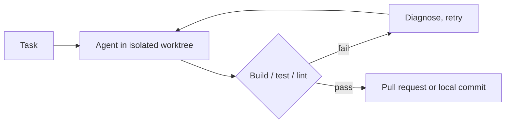

<div align="center">


# DevAgentForce

### Task in. Verified pull request out.

Your AI coding agents. Your hardware. Your build decides when it's done.


<a href="https://capitaltools.app/devagentforce"></a>

<!-- TODO: demo GIF + YouTube link -->

[Website](https://capitaltools.app/devagentforce) · [Docs](https://capitaltools.app/devagentforce/docs) · [Get started](docs/getting-started.md) · [Use cases](use-cases/README.md) · [Editions](docs/editions.md) · [Engineering](docs/engineering/README.md)

</div>

> Public documentation only. The product is proprietary. Downloads, full docs and changelog: [capitaltools.app](https://capitaltools.app/devagentforce).

## What it does

- **Describe a task.** An agent builds it in its own git worktree.
- **Your build checks it.** Build, test, lint. Pass, or it doesn't ship.
- **You get a pull request.** Gitea, GitHub, Azure DevOps — or a local commit.
- **Four agents. One form.** Claude Code, Codex, Antigravity, Pi. Failover built in.
- **Secrets stay sealed.** Encrypted vault. Redacted logs. Scanned before push.
- **Runs on your machine.** Linux, macOS, Windows, or one cloud VM.

## How it works



Watch every step live. Message the agent mid-run. Stop it anytime.

## Why it's different

| | |
|---|---|
| **Multi-vendor** | Rate-limited? The task moves to the next vendor. |
| **Verified** | Done means your tests passed. Not that the model said so. |
| **Any git host** | Including none. A dirty tree is never touched. |
| **Secure** | Vault, redaction, per-task secret grants, prompt-injection scan. |
| **Remembers** | Repo map on every run. Searchable memory with Pro. |

## See it

<table>
<tr>
<td><br/><b>Dashboard.</b> Queue, vendors, cost. At a glance.</td>
<td><br/><b>Tasks.</b> One list. Or a live pipeline board.</td>
<td><br/><b>Sessions.</b> Every live agent. Reply in place.</td>
</tr>
<tr>
<td><br/><b>Templates.</b> Save a kind of work. Rerun in one click.</td>
<td><br/><b>Skills.</b> Reusable procedures for any vendor.</td>
<td><br/><b>Ideas.</b> Decompose an idea. Turn a leaf into a task.</td>
</tr>
<tr>
<td><br/><b>Repositories.</b> Any host or local folder. Indexed.</td>
<td><br/><b>Secrets.</b> Sealed. Never comes back out.</td>
<td><br/><b>Crew.</b> Every instance on one page.</td>
</tr>
<tr>
<td><br/><b>Settings.</b> Concurrency, System LLM, model aliases.</td>
<td><br/><b>Logs.</b> Live tail, redacted through the vault.</td>
<td><br/><b>Task detail.</b> Timeline beside transcript.</td>
</tr>
</table>

## Use cases

| Use case | Outcome | Edition |
|---|---|---|
| [Ticket to verified PR](use-cases/01-ticket-to-verified-pr.md) | A PR that already passes CI | Free |
| [Plan, then implement](use-cases/02-plan-then-implement.md) | Approve the plan before code | Pro |
| [Overnight batch](use-cases/03-overnight-multi-vendor-batch.md) | Done by morning, despite rate limits | Free / Pro |
| [Local repo, no remote](use-cases/04-local-repo-no-remote.md) | A commit on your branch. Nothing pushed. | Free |
| [Pre-ship review loop](use-cases/05-pre-ship-review-loop.md) | Reviewed and fixed before you look | Pro |
| [Research with artifacts](use-cases/06-research-with-artifacts.md) | A `RESULT.md`, not chat scrollback | Free |
| [Scheduled skills](use-cases/07-scheduled-skills-job-search.md) | A skill on a schedule, with history | Free |

## Editions

| | Free | Pro |
|---|:---:|:---:|
| Pipeline, verification, retries, four vendors, failover | ✓ | ✓ |
| Every git host and flow, skills, Ask Agent, schedules | ✓ | ✓ |
| Secrets vault, external MCP servers | ✓ | ✓ |
| Subscription billing, live Sessions steering | | ✓ |
| Plan approval, review loop, budget breaker, PR secret scan | | ✓ |
| Memory, semantic search, MCP server, A2A gateway | | ✓ |

[Full comparison](docs/editions.md) · [Get Pro](https://capitaltools.app/devagentforce)

## Get started

```bash
curl -fsSL https://capitaltools.app/install.sh | bash        # macOS / Linux
irm https://capitaltools.app/install.ps1 | iex               # Windows PowerShell
```

Open the dashboard. Add a repo. Run a task. → [Getting started](docs/getting-started.md) · [Downloads](https://capitaltools.app/account/downloads)

## Documentation

[Docs index](docs/README.md) · [Handbook](docs/handbook/README.md) · [Features](docs/features/README.md) · [FAQ](docs/faq.md) · [Changelog](CHANGELOG.md)

## Engineering

For hiring managers: [how it's built](docs/engineering/README.md). Prose and diagrams. No source.

- **Crash-contained queue.** One bad job fails alone. → [Reliability](docs/engineering/reliability.md)
- **Enforced module seams.** Checked against the import graph. → [Design decisions](docs/engineering/design-decisions.md)
- **Every feature has a test ID.** Hundreds of them. → [Testing](docs/engineering/testing-strategy.md)

## Origin

Grew from [DevServer](https://github.com/sergiovision/DevServer), the open-source (MIT) MVP. DevAgentForce is the production rebuild.

## Built by Sergei Zhuravlev

Senior Full-Stack & AI Engineer. Twenty years of production systems for banks, trading desks and global retail. Now: agentic AI platforms that ship.

[LinkedIn](https://linkedin.com/in/sergeizhuravlev) · [GitHub](https://github.com/sergiovision) · [capitaltools.app](https://capitaltools.app)

## License

Docs: [CC BY-ND 4.0](LICENSE). Logos and art: all rights reserved. Third-party names belong to their owners — [TRADEMARKS.md](TRADEMARKS.md).
