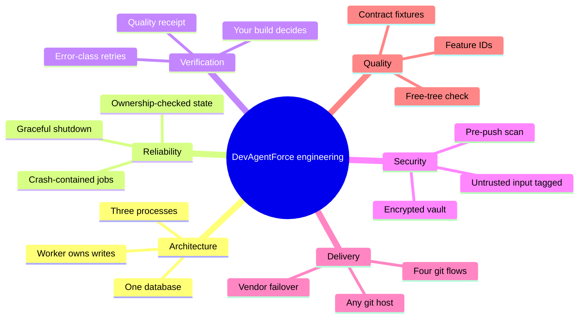

# How DevAgentForce is engineered

A self-hosted pipeline: AI agents write the code, real compilers and tests decide, only passing changes become pull requests.

For engineers and hiring managers. Prose and Mermaid only. No source code.

| Page | What it shows | Skills shown |
|---|---|---|
| [Architecture](architecture.md) | Three processes, one database, request to PR | System decomposition, fewer moving parts |
| [Task lifecycle](task-lifecycle.md) | Ordered phases, sequence and state diagrams | State machines, failure paths |
| [Data model](data-model.md) | ER diagram of 23 core entities | Relational modelling, integrity choices |
| [Design decisions](design-decisions.md) | Eight decisions as Context / Decision / Consequences | ADRs, modular monolith, retry strategy |
| [Reliability](reliability.md) | Queue guarantees, isolation, verification | Concurrency in PostgreSQL, degradation |
| [Security model](security-model.md) | Threat table, trust boundaries, vault | Threat modelling, fail-closed design |
| [Testing strategy](testing-strategy.md) | Gates, 479-ID feature catalogue, free-tree check | Test architecture, traceability |
| [Context economy](context-economy.md) | Lean brief, push-then-pull, compaction | LLM context engineering, token cost |
| [Tech stack](tech-stack.md) | Go, Next.js, PostgreSQL, Tauri, and why | Technology selection, operational simplicity |

Related: [Feature tour](../features/README.md) · [Editions](../editions.md) · [Project overview](../../README.md) · [Product](https://capitaltools.app/devagentforce) · [Documentation](https://capitaltools.app/devagentforce/docs#overview)
