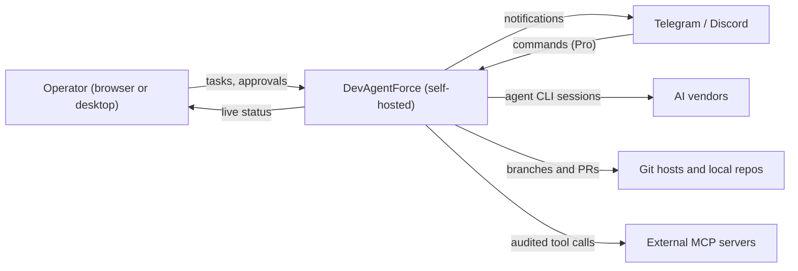
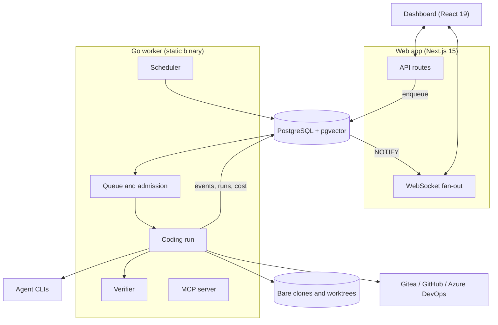

# Architecture

Three processes, one database. No broker. No cache tier.

- **Web app** (Next.js 15) takes requests and shows live state.
- **Go worker** runs the work.
- **PostgreSQL + pgvector** is system of record, job queue and event bus.
- Vendor agent CLIs do the coding as worker subprocesses.

Anything not running cannot fail at 3 a.m.

## System context

Everything in the DevAgentForce box runs on operator hardware. Code leaves only via the chosen agent CLIs and git hosts.

## Containers

| Container | Owns | Why separate |
|---|---|---|
| Web app | Pages, API routes, WebSocket relay, enqueue | Faster release rhythm. Browser never calls the worker. |
| Go worker | Queue, admission, lifecycle, verify, git, notify, cron | Long subprocesses and concurrency suit a static binary |
| PostgreSQL + pgvector | State, queue, pub/sub, vectors | One backup, one migration path, one truth |
| Agent CLIs | Code editing | Orchestrate existing harnesses, do not rebuild them |

## Request to pull request

1. **Request.** Dashboard, template, backlog idea, cron or client token. Injection scan at ingress.
2. **Queue.** Job row in the same database. A DB backup is a queue backup.
3. **Admission.** Same vendor + same repo runs serially. Different vendors run in parallel. Blocked work is deferred, not dropped.
4. **Worktree.** One worktree and branch per task, from a bare clone. Local repos follow stricter rules.
5. **Context.** Symbol map, references, attachments, skills. Pro adds feasibility check and memory recall.
6. **Agent.** Vendor CLI runs in the worktree. Tokens, cost and steps stream as typed events.
7. **Verify.** The project's pre-build, build, test and lint decide. Failures are classified. Hard failures escalate.
8. **Ship.** PR, branch, commit or patch. Pro adds a preflight scan before push.
9. **Notify.** Outcome, cost and duration to dashboard, analytics and chat.

## Invariants

- **One writer.** The worker owns domain writes. Web is a backend for the frontend.
- **One API client** in the browser. One error type.
- **Loopback by default.** Both bind `LISTEN_HOST`. Exposure via reverse proxy or private network.
- **Phase order is the lifecycle.** See [task-lifecycle.md](task-lifecycle.md).
- **One schema file**, mirrored byte for byte into the worker. The gate checks it.

## Trade-offs

| Choice | Gives up | Gets |
|---|---|---|
| PostgreSQL queue | Raw throughput | Transactional enqueue. Tasks run minutes, not ms. |
| Orchestrate CLIs, not model APIs | Four output formats to track | Vendor agent loops and subscription logins. Fixtures pin formats. |
| Self-hosting | Operator owns upgrades, backups | Single installer, desktop app, built-in backup/restore |

Related: [Task lifecycle](task-lifecycle.md) · [Reliability](reliability.md) · [Pipeline features](../features/pipeline-and-tasks.md) · [Git providers](../features/git-providers.md) · [Documentation](https://capitaltools.app/devagentforce/docs#overview) · [Product](https://capitaltools.app/devagentforce)
