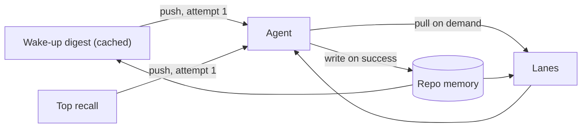

# Context economy

Context is a budget, not storage. Keep the agent's resident context well under about 120k tokens, where reasoning stays sharp.

## 1. Lean standing brief

- One short brief per vendor at the repo root.
- Holds only what is always true: layout, done-checks, invariants, safety rules.
- A topic table points to one doc per topic. Read on demand.

Trade-off: one extra read sometimes, versus the full brief on every turn.

## 2. Progressive disclosure

- **Repo map capped** by a per-deployment character budget. Largest block, re-read every turn.
- **Skills as a catalogue.** Full procedure loads only when called.
- **Cross-repo by reference.** Read-only access, not pasted copies.
- **Required constraints never truncated.** Optional material drops first. Too small an envelope is logged, not silently cut.
- **Manifest of what was sent** saved before each agent call.

## 3. Push a little, pull the rest (Pro)

- Attempt 1 gets a small cached wake-up digest and top recall.
- The agent pulls deeper lanes on demand: transcripts, facts, decisions, repo map. One bounded query each.
- Same lanes serve interactive console sessions through an MCP server.

A pull costs one round trip. A push costs every turn of every attempt.

## 4. Retries carry only the fix

Resumed sessions already hold the task. Retries send only the error and remediation block. About half the tokens per retry.

## 5. Bounded compaction

Summary in five sections: approaches tried, files changed, failure modes, next steps, open constraints.

- **Automatic** once per task after several retries. Also on demand, with enclosed operator instructions.
- **On context overflow:** compact once, fresh session, same attempt. No retry used. Only the CLI's own error fields trigger it, never agent or test output.
- **Lossy but traceable.** Pointers back to full transcripts. Failures stored as conditional lessons. Earlier summaries kept verbatim within budget. Over budget, it refuses rather than cuts.
- **Archived first** (Pro). Full transcript saved before compaction.

## Measured

Input (with cache reads) and output tokens per attempt, plus a task total. Charted per task over time. Meaningful even under flat-rate billing.

Related: [Memory features](../features/memory-and-knowledge.md) · [Messaging and compaction](../features/messaging-and-telegram.md) · [Handbook: memory](../handbook/memory.md) · [Documentation](https://capitaltools.app/devagentforce/docs#pro)
