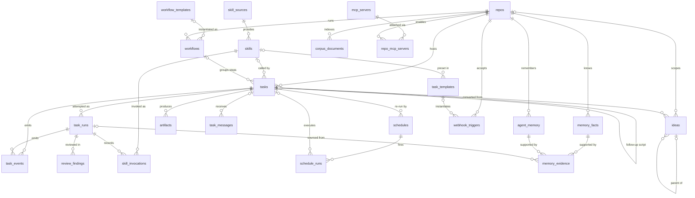

# Data model

One PostgreSQL database: records, job queue, event stream, embeddings. One migration file, about fifty-six tables. Below: the 23 core entities and their relationships.

## Groups

| Group | Entities | Key point |
|---|---|---|
| Work | repos, tasks, task_runs, task_events, review_findings | Runs separate from tasks: retries, failover and cost stay queryable |
| Reuse | skill_sources, skills, skill_invocations, task_templates, schedules, schedule_runs | Each schedule fire keeps its own result folder |
| Planning | ideas, workflows, workflow_templates | Ideas form a tree. Conversion keeps the link. |
| Outputs | artifacts, task_messages | A message to a not-yet-created task key waits for it |
| Knowledge | agent_memory, memory_facts, memory_evidence, corpus_documents | Every memory traces to its source run. Lexical lane works without embeddings. |
| Integrations | mcp_servers, repo_mcp_servers, webhook_triggers | Tools enabled per repository |

Repo-less tasks exist for research and skills. A task can chain to a post-success script task.

## Not drawn

- **Queue tables.** Keyed by task id, no foreign keys. Queue retention never cascades into domain data.
- **Repository locks.** Keyed by repo name, with expiry. Admission, not a relationship.
- **Vault secrets and audit.** Addressed by scope and name. A secret outlives the repo that used it.
- **Settings, daily stats, workers, client tokens.**

## Modelling choices

- **CHECK constraints, not enums.** Enum values cannot be added inside a transaction.
- **Delete behaviour per edge.** Sent messages survive. Messages to a deleted task go with it, so a reused key never gets stale mail.
- **One transactional boundary.** Create task + enqueue = one commit.

Related: [Architecture](architecture.md) · [Reliability](reliability.md) · [Memory](../features/memory-and-knowledge.md) · [Skills and artifacts](../features/skills-and-artifacts.md) · [Ideas backlog](../features/ideas-backlog.md) · [Documentation](https://capitaltools.app/devagentforce/docs#backup)
