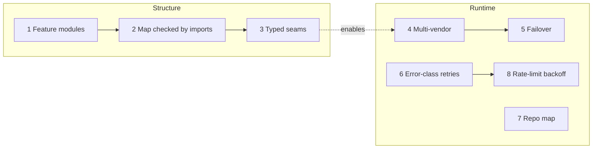
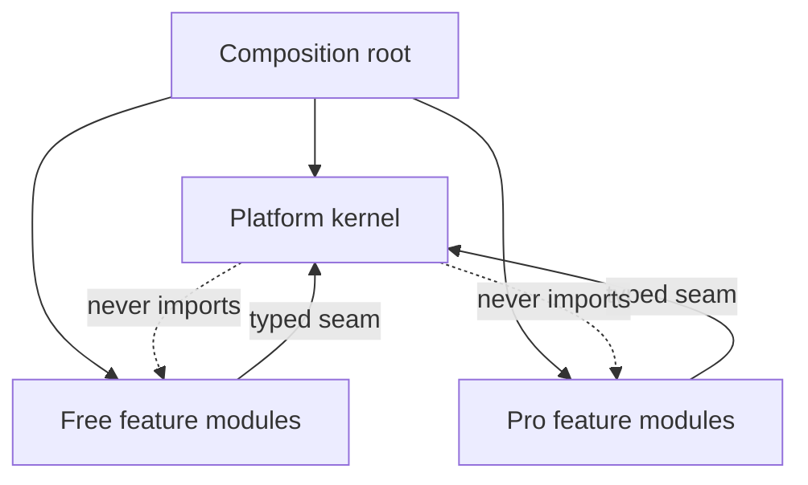
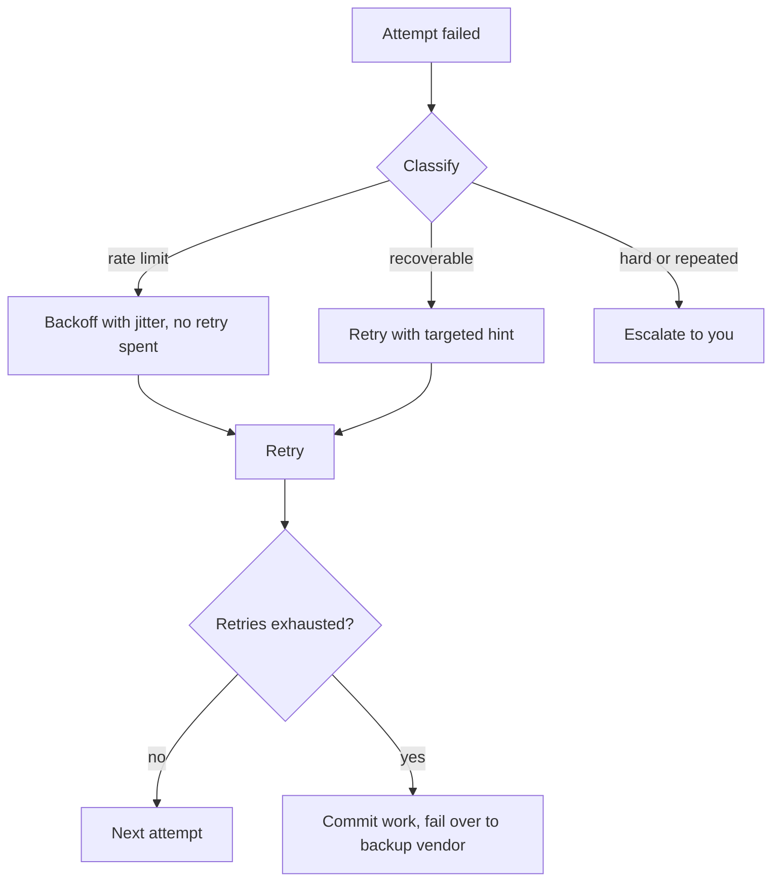

# Design decisions

Eight decisions. Three structural, five runtime. Each as Context / Decision / Consequences.

## 1. Feature modules on a small kernel

- **Context.** Code grew by licence tier, not domain. AI agents do much of the development and work best when one feature is one folder.
- **Decision.** Vertical feature modules on a small platform kernel, reached in behaviour-preserving steps. The worker owns all writes.
- **Consequences.** Every step keeps the gate green against a baseline. Phase order frozen. Tests enforce: the kernel imports no feature. A Pro build without a licence runs the free capability set.

## 2. Module map checked against the import graph

- **Context.** A whiteboard map is a hypothesis. Go forbids import cycles.
- **Decision.** Validate the map against the real import graph, tests and Pro build included. Change the map where the graph disagrees.
- **Consequences.** Each placement backed by evidence. Cycle risks found before the move get seam interfaces. Platform packages import only platform packages.

## 3. Typed capability seams, one composition root

- **Context.** Free and Pro were joined by eleven mutable globals. Nobody could tell what a nil hook meant.
- **Decision.** Each seam is a typed interface owned by its consumer, with a free default matching old behaviour. One composition root wires Free or Pro.
- **Consequences.** Allowed global hooks: zero, enforced by test. One recipe per new capability. Deleting all Pro sources still builds and passes ([free-tree check](testing-strategy.md)).

## 4. Multi-vendor agent backends

- **Context.** One provider means its prices, limits, outages and roadmap.
- **Decision.** One adapter per vendor: Claude Code, Codex, Antigravity (Gemini), Pi (OpenAI-compatible). Per-task vendor, model, billing mode.
- **Consequences.** Four formats to parse, pinned by recorded fixtures and fake CLIs. When Google retired its old Gemini CLI, only one adapter changed.

## 5. Automatic vendor failover

- **Context.** An overnight batch dead on one rate limit wastes the night.
- **Decision.** After the primary exhausts retries, commit work in progress, clear the session, start a fresh loop on the backup vendor.
- **Consequences.** No human needed. The backup starts from committed work, not session memory. Failover is its own event, so cost stays attributable.

## 6. Retries by error class

- **Context.** "Append stderr and retry" burns sessions and repeats mistakes.
- **Decision.** 20+ classification rules across Python, TypeScript/Node, .NET, Rust, Go, Java, git, shell. Recoverable gets a hint. Hard or repeated escalates.
- **Consequences.** Fewer wasted attempts, clearer reports. Rules need upkeep. Unknown errors fall back to plain evidence.

## 7. Multi-language repo map

- **Context.** Agents without a map waste turns discovering what does not exist.
- **Decision.** Regex symbol index for eleven languages before the agent starts, size-capped per deployment.
- **Consequences.** Fast, deterministic, no toolchain, draws module diagrams without an LLM. Approximate, which is fine for orientation.

## 8. Rate-limit hardening

- **Context.** Counting a rate limit as a failed attempt burns retries that waiting would fix.
- **Decision.** Backoff with jitter outside the retry count. Resumed retries send only the remediation block.
- **Consequences.** About half the tokens per retry. Rate-limit spikes show as delay, not failures.

Related: [Architecture](architecture.md) · [Testing strategy](testing-strategy.md) · [Agent backends](../features/agent-backends.md) · [Documentation](https://capitaltools.app/devagentforce/docs#vendors)
