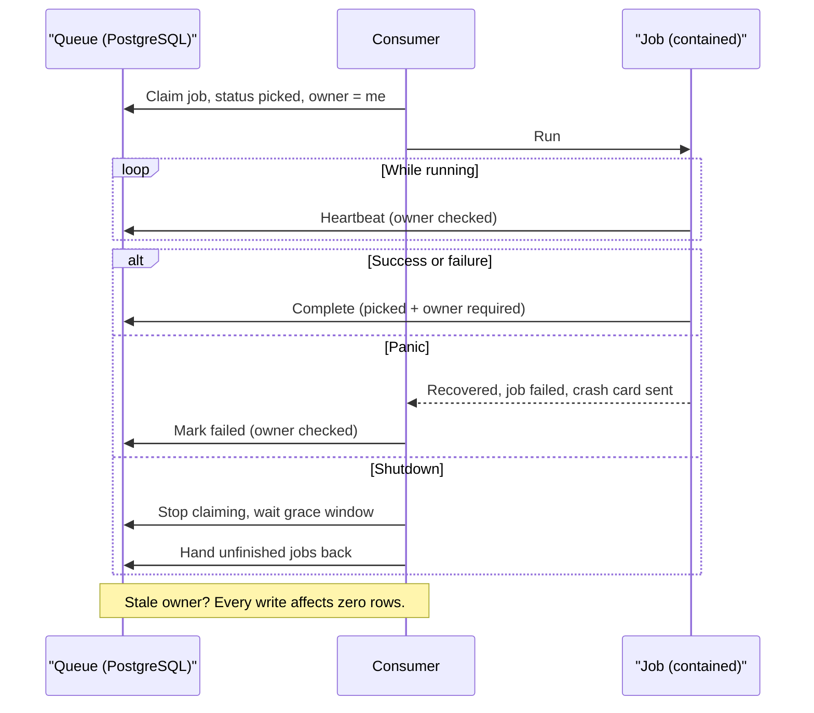
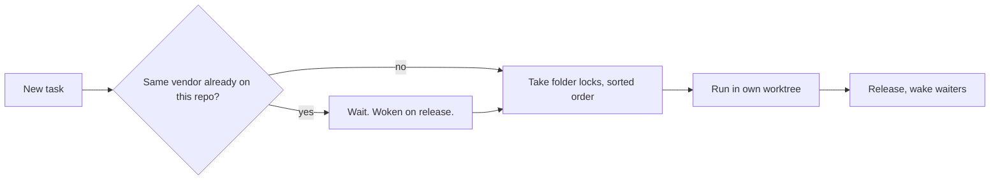

# Reliability

One bad task never takes down the worker, corrupts another task, or reports unverified success. Every guarantee has a feature ID and a test.

## Queue guarantees

PostgreSQL queue, row-level locking, plus:

| Guarantee | Behaviour |
|---|---|
| Crash containment | A panic fails only that job, logs it, sends a crash card. Consumer keeps running. |
| Graceful shutdown | Stop claiming. In-flight jobs get about 20 s, then go back to the queue. |
| LISTEN connection never recycled | Removed from the pool for good, then closed. No leaked subscriptions. |
| Ownership-checked transitions | Complete, defer, heartbeat, hand back require `picked` status and this consumer's ID. |
| Orphan reclaim | No heartbeat for minutes: reclaimed. A sweep re-enqueues queued tasks with no job. |
| Cleanup outlives cancellation | Detached, time-limited context. A transient lookup error defers, not fails. |
| Precise cancellation | Cancels only that task's job. |
| Pause is a flag | Stops claiming. Running work continues. |

## Admission

- Same vendor + same repo: serial. Different vendors: parallel, separate worktrees.
- Locks expire and renew before every agent call, for every folder held.
- Release wakes waiters at once. No polling delay.
- Multi-folder locks taken in sorted order. No lock-order deadlocks.

## Worktree isolation

- One worktree and branch per task, from a bare clone.
- Bare-clone changes serialised by a cross-process lock.
- No credential in the remote URL. Tokens supplied per operation.
- Worktree kept if the task may continue, else dropped. Cancelled runs save work first.
- Local repos: no copy, work in place under strict rules ([security-model.md](security-model.md)).

## Deterministic verification

An agent's "done" is not evidence. The repo's own commands decide:

1. Pre-build
2. Build
3. Test
4. Lint

- A **quality receipt** fingerprints the diff with each result. Verified change = shipped change.
- A hook refusing the commit is a failed attempt.
- Delivery short of the promised git flow is never success. No retry or failover changes that.

## Events

- Every step is a typed event, stored and pushed via NOTIFY.
- Oversized payloads are deferred to a fetch, never truncated.

## Graceful degradation

| Unavailable | Behaviour |
|---|---|
| Embedding service | Lexical search lanes |
| An evidence block | Omitted. Task proceeds. |
| Primary vendor rate-limited | Backoff without using a retry, then failover if set |
| Context overflow | One compaction and retry, no retry used |
| Notification channel | Logged. Outcome unaffected. |

Related: [Testing strategy](testing-strategy.md) · [Task lifecycle](task-lifecycle.md) · [Worker fleet](../features/worker-fleet.md) · [Pipeline](../features/pipeline-and-tasks.md) · [Queue FAQ](../handbook/faq-queue.md) · [Documentation](https://capitaltools.app/devagentforce/docs#troubleshooting)
