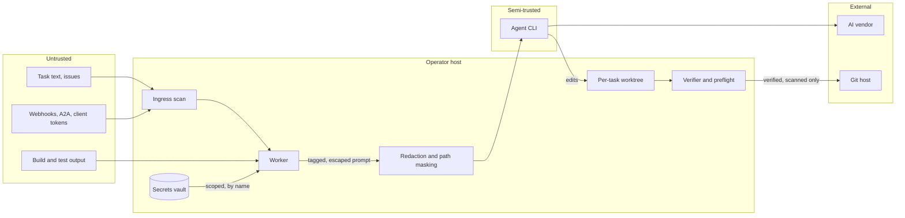
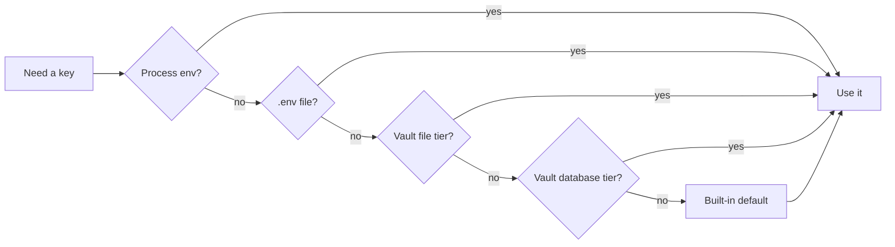
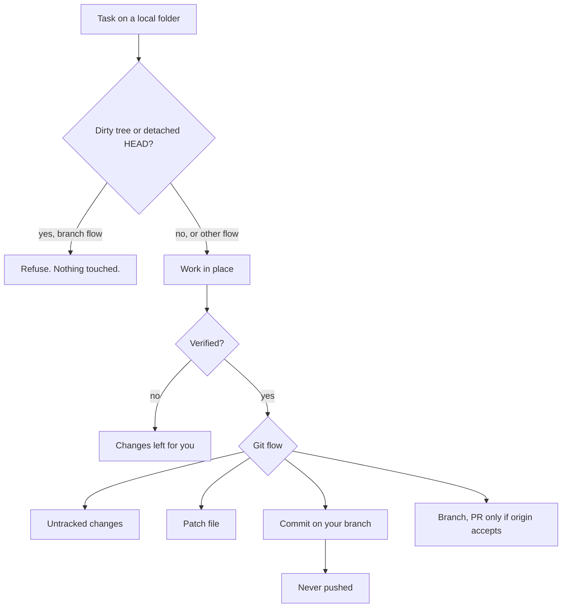

# Security model

The pipeline reads untrusted text, holds credentials, runs model-written code and pushes to real repos. Every edge is assumed hostile. Every edge gets a deterministic control.

## Trust boundaries

The agent is **semi-trusted**: it runs with worker permissions and does what the model decides. Controls sit on its edges. Sanitised input. Limited reach (worktree, scoped secrets, OS sandbox for Pi). Output verified, scanned and delivered by the worker.

## Threat model

| Threat | Mitigation | Edition |
|---|---|---|
| Hidden injection (invisible chars, cloaked comments) | Stripped at ingress, web and worker, before storage | Free |
| Injection via descriptions, evidence, messages | Enclosed in tagged, entity-escaped blocks, treated as data | Free |
| Plaintext secrets | AES-256-GCM vault. Fails closed. Key rotation. | Free |
| Secrets via API or UI | Metadata and fingerprint only. Explicit strict reveal. | Free |
| Secrets in logs or transcripts | Known values redacted everywhere, incl. git errors | Free |
| Over-broad secret access | Per-repo grants. Names logged, never values. | Pro |
| Agent commits a secret | Preflight scans added lines and forbidden files, blocks push | Pro |
| Out-of-scope or oversized changes | Preflight checks author, plan allow-list, file size | Pro |
| Host details to vendors | Paths masked, internal env vars stripped | Free |
| Damage to operator's local repo | No push, remotes, PRs, hard reset or forced clean | Free |
| Model code reading host credentials | Pi in OS sandbox (macOS, Linux): scoped writes, blocked credential reads | Free |
| Runaway cost | Budget breaker on cost and time, before every attempt | Pro |
| Spend on impossible tasks | Feasibility check with strict abstain | Pro |
| Open dashboard | `ENABLE_LOGIN_PAGE` covers every page and route. Ambiguous = on. Sessions tied to client address. | Free |
| CSRF and DNS rebinding | Origin guard and host-name check | Free |
| Network exposure | Loopback by default (`LISTEN_HOST`) | Free |
| Stolen client token | Hashed, constant-time compare, scoped, rate-limited, audited | Free |
| Admin-task escalation | Dashboard password + OS admin credential on stdin. Rights dropped after. | Free |

## Secrets resolution order

First layer that has the key wins:

1. Process environment (operator override)
2. `.env` file
3. Secrets-store file tier
4. Secrets-store database tier
5. Built-in default

- Migration to the vault is per key and reversible. Deleting from `.env` hands the key to the store.
- Pre-database keys (connection, vault location and key, sign-in flag) stay in the file tier. Sealed in the database, they would be unreadable at start-up.

## Local-repository safety

The folder belongs to the operator.

- No worktree, no bare clone. Work in place.
- Never push, touch remotes, open PRs, hard reset or force clean.
- Existing changes carried as they are. Branch flow refuses a dirty tree.
- The commit is the operator's own: no identity override, no trailer.

## Principles

- **Code, not model judgement**, makes every safety decision.
- **Fail closed.** No key, no sealing. No credential, no access. Ambiguous flag, gate on.
- **Secrets never printed, logged or returned.** Tests enforce it.

Related: [Security policy](../../SECURITY.md) · [Secrets vault](../features/secrets-vault.md) · [MCP](../features/mcp.md) · [Handbook: secrets](../handbook/secrets.md) · [Handbook: access](../handbook/access.md) · [Documentation](https://capitaltools.app/devagentforce/docs#security)
