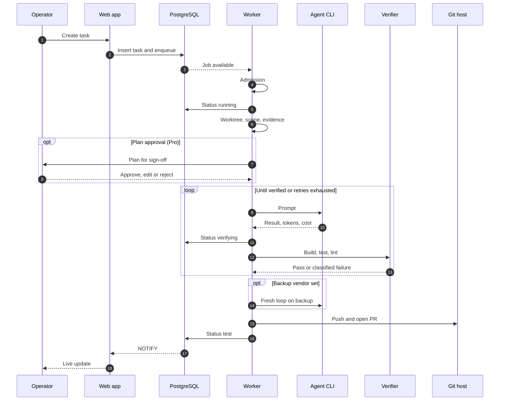
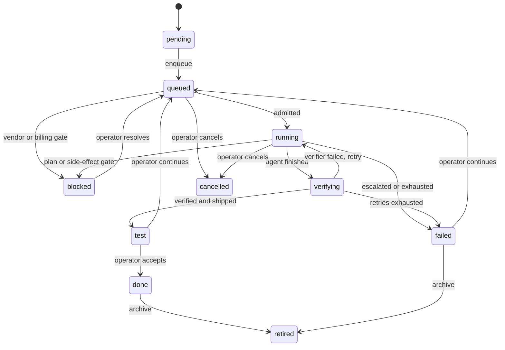

# Task lifecycle

A coding run is a fixed list of phases. The order is a contract: tests pin event names and order. A stopping phase always parks the task with a reason. No silent endings.

Light tasks (skills, research, admin, repo-less) skip verifier and PR.

## Phases

| # | Phase | What happens | Can stop? |
|---|---|---|---|
| 1 | Admission | Vendor active, billing allowed, repo lock | Deferred or blocked |
| 2 | Continuation | Load prior session. One-shot flag cleared at once. | No |
| 3 | Start | Log opens, status running, notification | No |
| 4 | Workspace | Worktree on own branch, granted folders attached | Setup failure |
| 5 | Inputs and scope | Pinned artifacts, cross-repo refs, scope | Unresolved input |
| 6 | Evidence | Repo map. Pro: feasibility check, memory recall. | Abstain (Pro) |
| 7 | Plan gate | Pro: human approves, edits or rejects | Rejected, timed out |
| 8 | Prompt blocks | Skills prepared. Unhonourable skill fails the task. | Yes |
| 9 | Attempt loop | Agent, commit, verify, review (Pro), preflight (Pro), ship | Escalation, budget, gate |
| 10 | Failover | Fresh loop on backup vendor if set | No |
| 11 | Accounting | One token total for the task | No |
| 12 | Outcome | Status, lessons, notification | No |
| 13 | Finish (always) | Save work, harvest artifacts, keep or drop worktree | No |

Finish runs detached from cancellation, with a time limit. Cancelled runs are the ones that most need saving.

## One attempt

1. Compact once if many retries used.
2. Check budget (Pro).
3. Build prompt. Full on first attempt, remediation only on retry.
4. Renew all locks. Run the agent in the worktree.
5. Record tokens, cost, duration.
6. Side-effect gate opened: suspend for a human.
7. Agent failed: classify. Rate limit backs off, overflow compacts, neither uses a retry. Hard class or same class twice escalates.
8. Agent succeeded: commit, verify. Failure evidence feeds the next attempt.
9. Ship. Success only after delivery is confirmed.

## Sequence

## Status machine

Success lands in **test**, not done. Only the operator accepts. The system never approves its own work.

## Design notes

- **Lock taken once, at admission.** A second in-run lock once deadlocked and stranded a task in queued.
- **Evidence degrades, never aborts.** A failed map or recall lane is just omitted.
- **Fail closed.** Bad skill, unresolved input or refused commit stops the run.

Related: [Reliability](reliability.md) · [Design decisions](design-decisions.md) · [Pipeline](../features/pipeline-and-tasks.md) · [Workflows](../features/workflows.md) · [Handbook: tasks](../handbook/tasks.md) · [Task finish](../handbook/task-finish.md) · [Documentation](https://capitaltools.app/devagentforce/docs#tasks)
