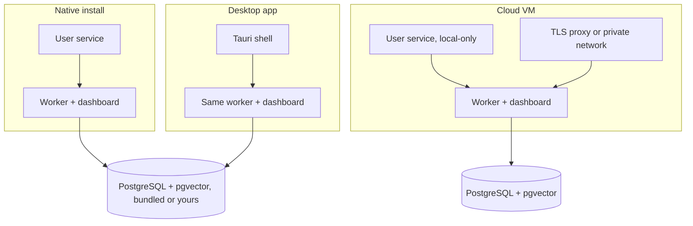

# Tech stack

Every choice removes a moving part. Goal: one operator installs, backs up and upgrades it without a platform team.

| Layer | Choice | Why |
|---|---|---|
| Worker | Go | Static binary, concurrency, subprocess control |
| Web | Next.js 15, React 19, CoreUI | Server pages, live client panels, API in one deployable |
| Database | PostgreSQL 16+ with pgvector (installers bundle 18.x) | Records, queue, pub/sub, vectors in one store |
| Queue | PostgreSQL-native | No broker. Enqueue commits with the task row. |
| Real-time | LISTEN/NOTIFY over WebSocket | No extra pub/sub service |
| Agents | Claude Code, Codex, Antigravity, Pi CLIs | Mature harnesses, not reinvented |
| Desktop | Tauri v2 (Rust) | Small native shell, macOS, Windows, Linux |
| Charts | Chart.js | Light analytics |
| Notifications | Telegram, Discord | Where operators already are |

## Go worker

- **One static binary.** No interpreter or runtime on the host.
- **Goroutines and contexts.** Every subprocess and call is cancellable. Cleanup gets its own time-limited context.
- **Mostly standard library.** Few dependencies. Boundary tests use the stdlib parser.
- **No import cycles**, so the compiler checks the module map.

Cost: a second language. Shared contract fixtures keep dual rules in step.

## Next.js web tier

- Server components for pages. Client components for live panels.
- API routes as backend for the frontend. Browser never calls the worker.
- One API client, two state hooks. Uniform errors and loading.
- Type-check in the gate. Node's built-in test runner.

Cost: public build-time variables need a rebuild to change.

## PostgreSQL, four jobs

1. System of record
2. Job queue (row locks, same-transaction enqueue)
3. Event bus (LISTEN/NOTIFY)
4. Vector store (pgvector plus full-text)

One backup includes work in flight. Bundled server or bring your own. Cost: queue throughput bounded by the database. Tasks last minutes, so never reached.

## Tauri desktop

- Runs the same files as the native install as supervised children: worker, portable Node with dashboard, private PostgreSQL.
- Uses the OS webview. No bundled browser.
- Rust handles supervision, tray notices, on-device dictation.
- One release, one data dir, one database with the console install. If it is already running, the app opens it.

## Deliberately absent

- **No Redis, RabbitMQ, Celery.**
- **No container runtime required.** Native installers, same stack on cloud VMs.
- **No custom agent loop.** DevAgentForce is the harness: queue, isolation, verification, delivery, observability.

Related: [Architecture](architecture.md) · [Desktop app](../features/desktop-app.md) · [Handbook: native](../handbook/native.md) · [Handbook: desktop](../handbook/desktop.md) · [Requirements](https://capitaltools.app/devagentforce/docs#requirements) · [Downloads](https://capitaltools.app/account/downloads)
