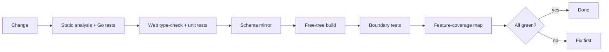
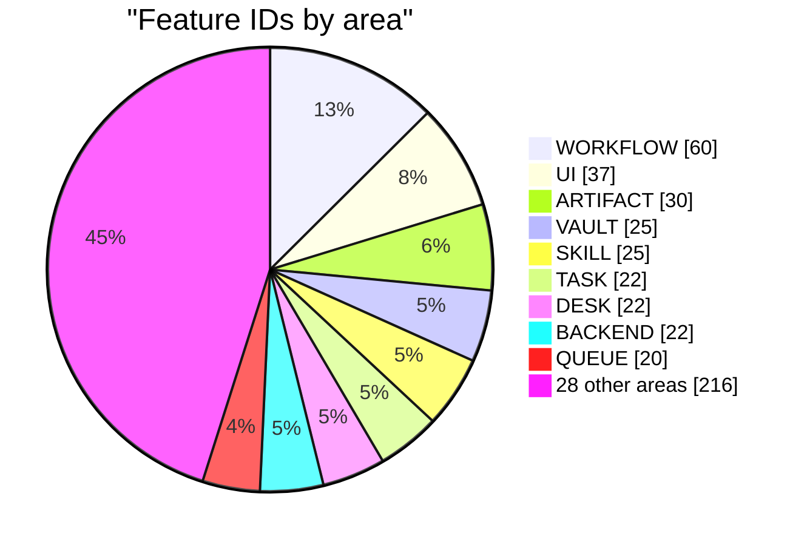

# Testing strategy

The product checks AI changes with deterministic tools. The codebase meets the same bar. Done means the covering gate is green.

## Layers

| Layer | Proves | Runs |
|---|---|---|
| Unit | One module via its public surface | Always |
| Integration | Queue, locks, scheduler, runner on PostgreSQL | With a test DB. Loud skip otherwise. |
| Contract | Golden files, shared Go/TypeScript fixtures | Always |
| Smoke | Every public surface answers | Live stack |
| End-to-end | Real app, real browser, fake agent CLIs | On demand |

One engine per language: Go test tooling, Node's built-in runner, Playwright. Fake CLIs replay recorded vendor output. No real model is ever called. Free and repeatable.

## The gate

One script, plus a PowerShell twin:

- Static analysis and Go tests
- Web type-check and unit tests
- Schema mirror check (byte for byte)
- Free-tree check
- Structural boundary tests, both tiers
- Feature-coverage map

Without a database it prints "integration skipped". Green never fakes full coverage.

## Feature catalogue

Each behaviour has a stable **`F-<AREA>-<NN>`** ID. Each test cites its ID on the line above.

- Never reused or renumbered. Retired rows stay.
- About one documented rule per ID.
- A script reports untested features and orphan citations. Row first, then test.
- Delete a test only if another still cites its ID.

**479 IDs, 37 areas, 453 live.**

| Areas | IDs |
|---|---:|
| WORKFLOW 60 · UI 37 · ARTIFACT 30 | 127 |
| VAULT 25 · SKILL 25 · TASK 22 · DESK 22 · BACKEND 22 | 116 |
| QUEUE 20 · MCPREG 19 · MEMORY 18 · RUNNER 15 · REVIEW 14 · AUTH 14 | 100 |
| INSTALL 12 · CONTEXT 11 · UPDATE 10 · LICENSE 10 · SESSIONS 9 · GIT 9 · test toolkit 8 | 69 |
| TELEGRAM 6 · PREFLIGHT 6 · LOCAL 6 · I18N 6 · NOTIFY 5 · IDEAS 5 | 34 |
| SCRIPT 4 · NATIVE 4 · BACKUP 4 · ADMIN 4 · A2A 4 · DICTATION 3 · CREW 3 · ARCH 3 · PATCH 2 · BUDGET 2 | 33 |

"Where is the test for this rule?" is answered by search, not memory.

## Free-tree check

Copy the checkout. Delete every Pro source and the Pro wiring. The rest must build, lint, pass Go tests, type-check and pass web tests. The edition boundary is verified by the build, not by convention ([design-decisions.md](design-decisions.md)).

## Cross-language contracts

Logic in both tiers reads one shared fixture: provider detection, model aliases, vendor list, redaction, vault decryption, secret grants, local git flows.

- Change the fixture, the other side turns red.
- Known divergence is a named bug in the fixture. Tracked, not hidden.

## Database test isolation

- Skip unless a test DB URL is set.
- One helper: checks schema, holds a DB-wide advisory lock, closes its pool.
- Fixture rows use schema defaults, removed by per-test prefix.
- Git fixtures ignore global config and caller environment.
- Wait by polling with timeout. Never fixed sleeps.

## Working rules

1. Test first. Red, green, refactor in vertical slices.
2. Moving a test never changes what it checks.
3. Golden files rewritten only on request.
4. Web unit suite stays under thirty seconds.

Related: [Reliability](reliability.md) · [Design decisions](design-decisions.md) · [Contributing](../../CONTRIBUTING.md) · [Documentation](https://capitaltools.app/devagentforce/docs#overview)
