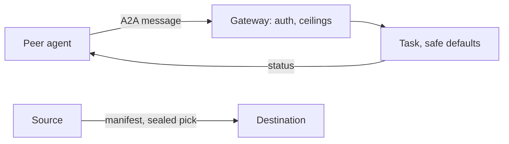

# A2A gateway and crew migration

**Pro.** Other AI agents delegate work to DevAgentForce over Agent2Agent. Your instances share configuration.

## Agent2Agent 1.0 endpoint

- Agent Card at the standard well-known address.
- JSON-RPC: send, stream progress, read, cancel, push notifications.
- States: submitted, working, input-required, completed, failed, canceled, rejected.
- A task waiting on a plan decision reads *input-required*. A person must act.
- Remote MCP uses the same peer credential to reach the [built-in MCP server](mcp.md).

## Peer governance

Each peer has its own credential. Only its hash is stored.

New peers start safe:

- No repositories.
- Research tasks only.
- Plan approval required.
- Patch git flow forced. Nothing is pushed.

Also enforced:

- Per-peer cost and wall-time ceilings.
- Tasks tagged with the peer name. A peer sees only its own.
- Returned text redacted, host paths stripped.
- Push targets on private or loopback networks refused.
- Read-only external tools only.

## Crew migration

A new laptop or team server pulls from an existing instance: repository secrets, task templates, Ideas backlog.

- **The token is the permission.** Import needs a crew credential the source issued. Revoke it to cut access.
- **Opt-in on the source.** Off by default. Secret values need a separate switch.
- **See before you take.** The manifest lists names and paths, never values. Values travel encrypted.

The gateway runs in the dashboard tier, behind the same authentication and origin checks.

Callers cannot raise ceilings or skip approval gates. A second machine is ready in minutes, not by copying `.env` files.

**Related:** [Product docs](https://capitaltools.app/devagentforce/docs#pro) · [Integrations](../handbook/integrations.md) · [Pro features](../handbook/pro.md) · [Worker fleet](worker-fleet.md) · [MCP](mcp.md) · [Secrets vault](secrets-vault.md) · [Security model](../engineering/security-model.md)
