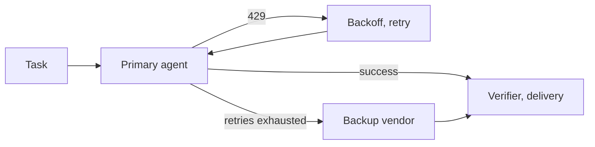

# Agent backends

**Free** for all four backends, failover and API-key billing. **Pro** adds subscription billing. Pick vendor and model per task. Fail over automatically.

## Vendors

| Vendor | Agent CLI | Notes |
|---|---|---|
| Anthropic | Claude Code | Most exercised path |
| OpenAI | Codex | |
| Google | Antigravity | Gemini. Effort level is in the model name |
| Pi | Pi coding agent | Any OpenAI-compatible endpoint. Off by default |

Worktree, verifier, retries and delivery stay the same for every vendor.

## Features

- **Floating aliases.** "Latest Opus" resolves to the newest model. Settings shows the mapping.
- **Failover.** Primary exhausts retries → backup vendor and model, fresh session. Committed work kept.
- **Rate limits.** Retried in-call with backoff. No task attempt spent. Retries send only error and fix hint.
- **Token accounting.** Input, cache-read and output tokens per attempt. Feeds cost charts.
- **Vendor switch.** Settings → Vendors → **Active**. Inactive: hidden, new tasks refused, queued fail, running finish.
- **System LLM.** Fill Task, plans, compaction and Ask Agent use a separate, cheaper model.

## Billing modes

| Mode | Edition | How |
|---|---|---|
| API key | **Free** | Per-token billing. Needed for cost tracking and dollar budgets |
| Subscription | **Pro** | API key removed from agent env. CLI uses host login: Claude Max, ChatGPT Plus, Google AI Pro or Ultra. Reports zero cost |

An API-key run never falls back to a subscription. Missing or rejected key: the task stops and says why. API-mode failover needs the backup vendor's key.

## Pi

1. Settings → Vendors → turn Pi on, install.
2. Add an endpoint. Presets: OpenRouter, Z.AI.
3. Press **Test**. It proves the model can call tools.
4. **Scan** finds models on saved endpoints and local model servers.
5. Set per-token prices on paid models to enforce dollar budgets.

- Always billed by API key.
- macOS and Linux: OS sandbox by default. Writes only task folders. No SSH, cloud or agent credentials. Network open.
- Windows or no sandbox: run untrusted repositories on a disposable VM.
- Approved Pi packages pin to an exact version, install once, enable per run.

Every vendor has outages. Same harness, swappable agent: route each job to the best model and compare on verified results.

**Related:** [Product docs](https://capitaltools.app/devagentforce/docs#vendors) · [Agents, models and billing](../handbook/vendors.md) · [Settings](../handbook/settings.md) · [Architecture](../engineering/architecture.md) · [Design decisions](../engineering/design-decisions.md) · [Context economy](../engineering/context-economy.md) · [Overnight multi-vendor batch](../../use-cases/03-overnight-multi-vendor-batch.md) · [Free vs Pro](../editions.md)
