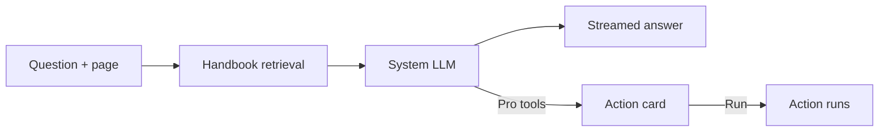

# Ask Agent

**Free** chat drawer on every screen. Knows the product, your page, your task. **Pro** adds tools behind Run / Edit / Reject.

## What you get

- **Open:** header button, `Cmd/Ctrl + J`, or the command palette.
- **Grounded.** Answers come from a handbook shipped with each version. Streamed.
- **Page-aware.** On a task page, "Why is this stuck?" means that task.
- **Recovery mode.** No System LLM? Falls back to a `.env` API key or the Claude Code CLI login. Guides a clean machine through database and secrets setup. No model at all: tells you how to get one.
- **Covers first run:** setup, checklist, FAQ, vault, sign-in, skills, attachments, review loop, backlog, native installs, updating, troubleshooting.
- **Chat keys:** Enter sends. Shift+Enter new line. `/` commands and skills. `@` task, repo, folder, skill. Mic dictates. Up arrow recalls. Edit and resend a stopped answer.
- **History:** last 20 conversations in your browser. Rename, delete, export as markdown.
- **Model per turn.** Vendor stays a Settings choice.
- **Pre-filled questions.** Pages can fill one in. Never auto-sent.

## Agent tools (Pro)

On the Claude Code CLI the drawer gains tools:

- Semantic code and doc search across repositories.
- Memory knowledge base and past decisions.
- Live task state: diffs, logs, spend.

It can **propose**: create, continue, retry or cancel a task. Save a memory, idea, template or skill. Start a workflow. Restart a down database.

Every proposal is a card: **Run / Edit / Reject**. Nothing runs until you click Run. No shell of its own.

Retrieval scores topics by keyword and page. Deterministic and tested: "nothing happens" and "how do I update?" reach the right topic. A drawer link opens the full public docs.

Setup is where self-hosted tools fail. This turns support tickets into thirty-second answers.

**Related:** [Product docs](https://capitaltools.app/devagentforce/docs#ask-agent) · [The assistant](../handbook/assistant.md) · [Getting started](../handbook/getting-started.md) · [Troubleshooting](../handbook/troubleshooting.md) · [Memory and knowledge](memory-and-knowledge.md) · [MCP](mcp.md) · [Desktop app](desktop-app.md) · [Install and first run](../getting-started.md)
