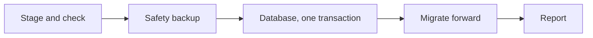

# Backup and restore

**Free.** One encrypted archive. Restore on this machine or a new one.

## Contents and protection

- Database, `.env` settings, secrets store and its key.
- Optional: skills, libraries, task results. Optional exclusion: memory and search index (reindex after restore).
- AES-256-GCM, passphrase-derived key. Tampering, truncation, reordering detected.
- Readable manifest. No secrets in it.

> A backup with the vault key is as sensitive as the key. Use a strong passphrase.

**Run it from:** Settings → Backup & Restore, the first-run checklist, the host command line, the installers, or a vault-backed hourly schedule. Ask Agent `/backup` and `/restore` show status and a link. They never ask for a passphrase in chat.

## Restore

1. **Stage.** Passphrase, checksum, compatibility.
2. **Safety backup** of the current state.
3. **Apply** at next worker start, before the database opens.
4. **Database** in one transaction. Any error rolls back.
5. **Migrate** forward. Re-seal secrets.
6. **Report:** each step ok, partial or failed.

| Item | Rule |
|---|---|
| Host wiring (DB connection, ports, paths) | Kept from this machine |
| API keys, tokens, sign-in, app settings | From the backup |
| Vault key | Existing kept, secrets re-encrypted. None: adopted |
| Older build / newer build | Migrated forward / needs force |
| Newer PostgreSQL major | Always refused |
| Selective | Database, secrets, skills, results |

New laptop or dead disk: a routine step, not a rebuild.

**Related:** [Product docs](https://capitaltools.app/devagentforce/docs#backup) · [Restore FAQ](../handbook/faq-restore.md) · [Secrets](../handbook/secrets.md) · [Settings](../handbook/settings.md) · [Secrets vault](secrets-vault.md) · [Desktop app](desktop-app.md) · [Reliability](../engineering/reliability.md) · [Data model](../engineering/data-model.md)
