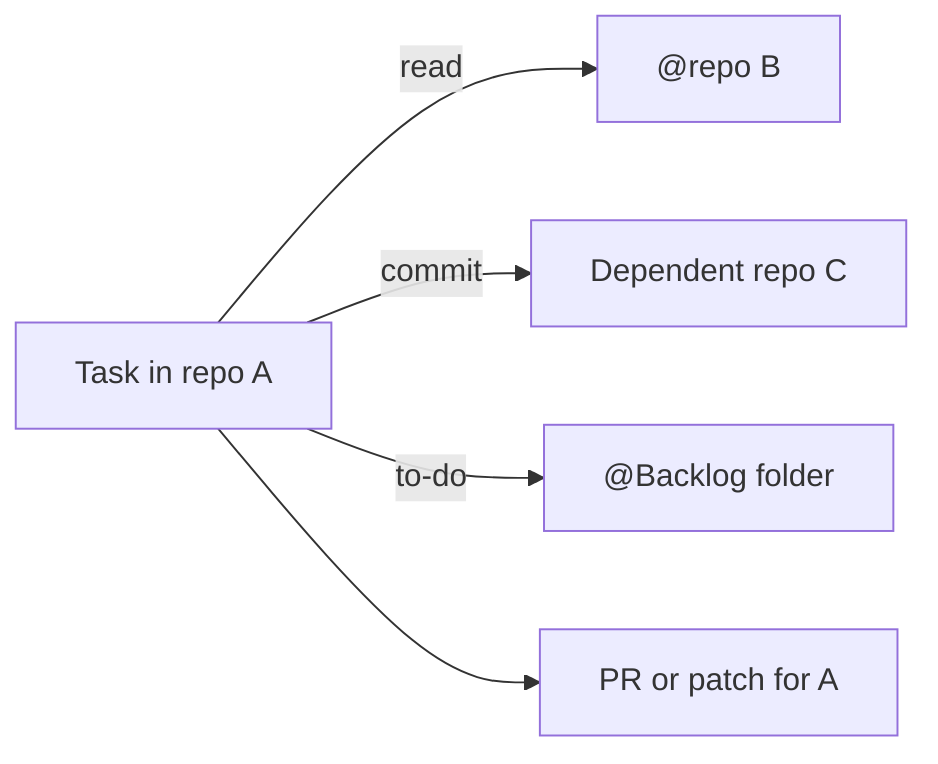

# Working across repositories

**Free.** A task belongs to one repository. It can read others, commit in granted ones, and take a backlog folder as its to-do list.

## Three grants, three places

| Mechanism | Grants | Set by |
|---|---|---|
| `@repo_name` in task text | Read-only knowledge | Task author |
| Dependent repositories and folders | Read, edit, commit | Repository settings |
| `@Backlog: Folder/Path` | A to-do list from the Ideas tree | Task author |

## `@repo_name`: read only

- Write `@billing-service` in title, description or acceptance criteria.
- The agent learns to query its symbol map and search index.
- Matched against active repositories only. Emails and decorators never match.
- Unmatched names are reported on the timeline.
- Up to four repositories per task.

## Dependent repositories: write access

One task: "change the API type in the backend so the frontend compiles."

- The grant belongs to the **repository**. Webhooks, imports and remote agents cannot widen it.
- Commits land on the branch already checked out.
- Never creates a branch, pushes, resets, cleans, checks out or stashes.
- Untracked main flow → dependent checkouts stay uncommitted.
- Granted folders are reserved with the task's repository. No two tasks edit one folder.
- Claude Code and Codex get them as writable workspaces. Other CLIs: the task says the grant was not applied.

## `@Backlog`: a list of work

Point a task at an [Ideas backlog](ideas-backlog.md) folder. The agent gets every item and the bound repository.

**Known limit.** PR preflight and patch export cover only the task's own repository. The agent lists every dependent folder it touched, with a summary, in its final message.

Real changes cross repository lines. One agent makes the whole change. Scope stays explicit.

**Related:** [Product docs](https://capitaltools.app/devagentforce/docs#repos) · [Repositories](../handbook/repos.md) · [Templates and ideas](../handbook/templates-ideas.md) · [Git providers](git-providers.md) · [Ideas backlog](ideas-backlog.md) · [Memory and knowledge](memory-and-knowledge.md) · [Security model](../engineering/security-model.md)
