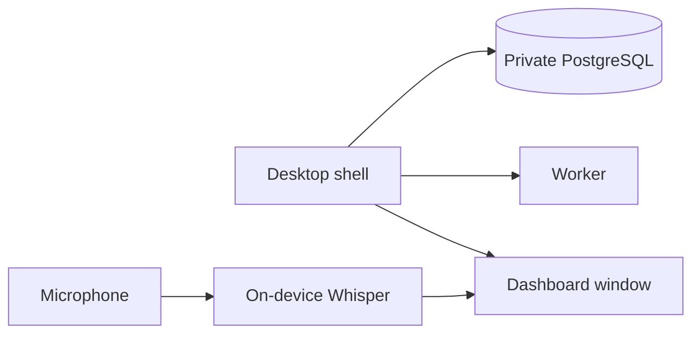

# Desktop app and dictation

**Free.** The full stack in a native window. Speech-to-text on your own machine. Pro features unlock inside the same app.

## The app

- **Platforms:** macOS (Apple Silicon), Windows x64, Linux x64. Installers on your [downloads page](https://capitaltools.app/account/downloads).
- **Self-contained.** Worker, dashboard and private PostgreSQL with pgvector. No Docker. No separate database.
- **Attach or own.** A native service is running: the app opens it and leaves it on quit. Otherwise the app supervises its own. Same home folder either way.
- **Self-healing.** Services start in order, each after the previous is healthy. Worker or dashboard dies: both restart with backoff. Database stays up.
- **Tray.** Closing hides the window. Tasks keep running. Tray shows task count, pauses and resumes the queue, announces builds, confirms quit during runs.
- **No sign-in in the app.** The person at the machine is the operator. Browsers still get the login page if `ENABLE_LOGIN_PAGE` is on.
- **No macOS privacy prompts mid-run.** Agents see a private home without Desktop, Downloads or other apps' data.
- **Schema guard.** Database upgraded by a newer build: the worker will not start. Update first.
- **Updates on your terms.** Never self-updates. The tray shows a one-line install command. Re-run it to update.

## Dictation

- Mic button in the task form and Ask Agent. Phrase in progress shown greyed. Finished phrases typed in.
- **Desktop: on-device Whisper.** Downloaded once, checksum-verified. No cloud key. No quota. No audio leaves the machine.
- **Shared.** The app serves the local console dashboard too, after one tray confirmation.
- **Language per device**, so accents are not misread.
- **Outside the app:** server-side, via Google Gemini with your key or a self-hosted Whisper server.
- Live dictation needs HTTPS or localhost. Plain HTTP records a clip instead.

Double-click install. Same data layout as a server. Start local, move up later.

**Related:** [Install docs](https://capitaltools.app/devagentforce/docs#install) · [Dictation docs](https://capitaltools.app/devagentforce/docs#dictation) · [Downloads](https://capitaltools.app/account/downloads) · [Desktop app](../handbook/desktop.md) · [Native install](../handbook/native.md) · [Updating](../handbook/updating.md) · [Install and first run](../getting-started.md) · [Tech stack](../engineering/tech-stack.md)
