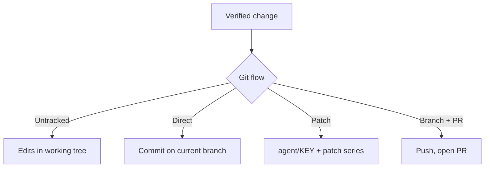

# Git providers and git flows

**Free:** four git flows on every host, PRs on Gitea, GitHub and Azure DevOps. **Pro:** patch export and PR preflight.

## Repository types

| Type | Connects with | Pull requests |
|---|---|---|
| Gitea / Forgejo | HTTPS, per-repo or global token | Gitea API |
| GitHub (incl. Enterprise Server) | HTTPS, classic, fine-grained or App token | GitHub API |
| Azure DevOps (cloud and Server) | HTTPS, personal access token | Azure DevOps API |
| Local Git | A folder on the worker machine | Optional, best effort |

- Tokens are never shared between providers. Per-repo beats global.
- **Local Git works with any host.** Clone from GitLab, Bitbucket or a NAS. Point at the folder. Nothing leaves your machine.
- Remote repositories are bare reference clones. Each task gets its own worktree. No collisions.

## Four git flows

| Flow | Result |
|---|---|
| **Untracked** (default) | Files edited. No branch, no commit. You review and commit |
| **Direct commit** | One commit on the current branch |
| **Patch** | Commits on local `agent/<task key>`, exported as a patch series. Original branch restored |
| **Branch + PR** | Commits on `agent/<task key>`, push, open PR. Local repo without remote: branch stays local, task succeeds |

## Local folder guarantees

- No push. Remotes untouched.
- No hard reset. No clean.
- Your uncommitted changes are carried along, never discarded.
- Commits use your git identity. No AI trailers or co-author tags.
- Patch flow refuses a dirty working tree.

## Pro

- **Patch export.** One combined mailbox file per task. Download, apply with `git am`.
- **PR preflight.** Before push: scan for secrets and forbidden files, reject oversized files, check files stay within the approved plan.

## Deploy command

Optional per repository. Runs in the real checkout after a task, separate from verification. Off by default. No surprise restarts.

You choose the reach: from "edit files" to "open the PR".

**Related:** [Product docs](https://capitaltools.app/devagentforce/docs#repos) · [Repositories](../handbook/repos.md) · [When a task finishes](../handbook/task-finish.md) · [Cross-repo work](cross-repo.md) · [Pipeline and tasks](pipeline-and-tasks.md) · [Security model](../engineering/security-model.md) · [Local repo, no remote](../../use-cases/04-local-repo-no-remote.md)
