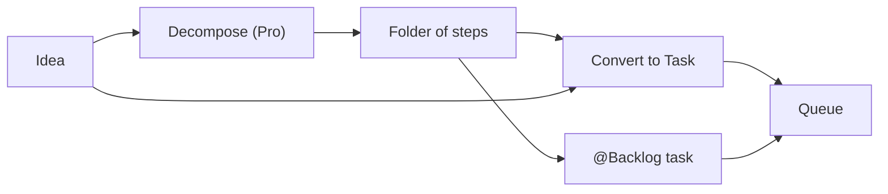

# Ideas backlog

**Free:** tree, repository binding, Convert to Task, `@Backlog`. **Pro:** Expand / Decompose and Azure DevOps import. Ideas become tasks one idea or one folder at a time.

## The tree

- **Folders and ideas.** Markdown leaves. Brainstorm and backlog in one.
- **Drag.** Drop *between* rows to reorder. Drop *onto* a folder to file. Saved in one step.
- A folder cannot move inside itself.
- Keyboard drag and drop, F2 rename, filter box.
- **Inherited binding.** Bind a folder to a repository. Contents follow unless they name their own. Moving a subtree re-binds it.
- **Multi-select.** Ctrl/Cmd-click, Shift-click. Delete confirms with a count.
- **Counts.** Direct items per folder. Full count on hover.
- **Splitter** remembered per browser. Stacks on small screens.
- **Save from a session.** Select transcript text in Sessions. Tables and code stay markdown.
- **Roll up.** Summarise a subtree into its parent.

## Into work

- **Convert to Task.** Title → title, body → description, repository preselected. Pick *Research* for a plan instead of a diff.
- **Whole folder.** `@Backlog: Root/Payments` gives the agent every item and the repository. See [Cross-repo work](cross-repo.md).

## Pro

- **Expand / Decompose.** The System LLM reads the idea and the repository's symbol map. Output: ordered, atomic steps, each one agent run, with acceptance criteria, dependencies and a resolvability score.
  - Lands as a **new folder next to the idea**. The idea is kept.
  - Nothing is queued until you decide.
  - Long documents are read in passes, not cut off.
- **Azure DevOps import.** Work items become pending tasks or ideas in a folder you pick.
  - Re-import skips seen items.
  - Changed item: updates an unstarted task, adds a note to a started one.

Typical loop: write, decompose, prune, promote.

Vague, oversized requests sink agent work. This turns "we should..." into a scoped task.

**Related:** [Product docs](https://capitaltools.app/devagentforce/docs#ideas) · [Templates, ideas and schedules](../handbook/templates-ideas.md) · [Integrations](../handbook/integrations.md) · [Cross-repo work](cross-repo.md) · [Pipeline and tasks](pipeline-and-tasks.md) · [Workflows](workflows.md)
