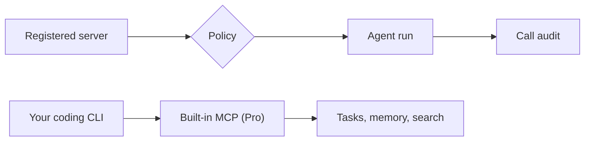

# MCP: external servers and the built-in server

**Free:** external MCP servers per repository, tool classes, call audit. **Pro:** the built-in DevAgentForce MCP server.

## External servers in agent runs (Free)

Only servers you registered and reviewed.

- **Registry, not inheritance.** Host and repository MCP configs are ignored. A run gets its repository's servers only.
- **Tool classes:** read, write, writable (destructive).
- Names with delete, remove, destroy, purge, drop or truncate are always destructive.
- **Policy by origin:**

| Origin | Allowed |
|---|---|
| Dashboard tasks | Read and write. Destructive needs a host setting |
| Webhooks, integrations, remote agents | Read only |
| Any tool | Can be denied |

- **Change review.** New write or destructive tools are held for review. Approved tools keep working.
- **Secrets stay in the [vault](secrets-vault.md).** Headers and env values are references. Never written to disk.
- **Call audit** on the task page under **External tools**: server, tool, class, errors, redacted input.
- **Presets:** documentation lookup, Atlassian Jira and Confluence. Custom stdio or streamable-HTTP. Import `.mcp.json`.
- **Per-vendor status.** A CLI that cannot enforce per-run policy gets nothing mounted. Settings says why.

## Built-in server (Pro)

Drive DevAgentForce from any MCP-capable coding CLI.

| Area | Tools |
|---|---|
| Task control | Options, create, run, continue, retry, cancel. Status, output, diffs |
| Knowledge | Wake-up digest, memory search and save, repo map, code and doc search, session search |
| Operator reads | Redacted logs, analytics, repositories, templates, schedules, MCP registry |
| Planning | Skills, backlog trees, add ideas, save templates, list and start workflows |

- Every tool honestly declares read, change or destructive.
- Served over HTTP to remote agents with [A2A gateway](a2a-gateway.md) peer credentials.

Useful tools for agents. No destructive tool for every remote trigger.

**Related:** [Product docs](https://capitaltools.app/devagentforce/docs#mcp) · [MCP](../handbook/mcp.md) · [Integrations](../handbook/integrations.md) · [Memory and knowledge](memory-and-knowledge.md) · [Secrets vault](secrets-vault.md) · [A2A gateway](a2a-gateway.md) · [Security model](../engineering/security-model.md)
