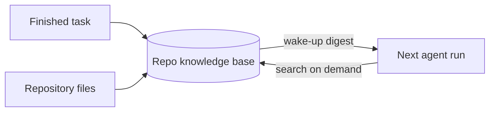

# Memory and knowledge

**Pro:** per-repository memory, hybrid recall, semantic code and doc search. **Free:** repo map and the optional local embedding service. Agents stop starting from zero.

## Per-repository memory

- **Stored:** notes, facts, decisions, lessons, relationships. Plain prose, optional metadata.
- Searchable at once. Treated as a hint, not proven truth.
- **Failure lessons, automatic.** A final failure saves a short lesson. Repeats update it.
- **Decisions** keep problem, choice and reasoning. The next agent knows *why*.
- **Facts can be invalidated.**
- **Wake-up digest.** Short, cached summary at task start.
- **Pull, not push.** Little memory in the prompt. Agents pull transcripts, facts, decisions and repo-map views on demand.
- **Feedback:** helpful, not helpful, stale, wrong. Changes ranking and archiving.
- **Memory lint.** Report-only. Finds near-duplicates and conflicts. You merge, invalidate or dismiss.

## Semantic code and doc search

- Code and docs chunked and indexed.
- **Hybrid retrieval:** vectors plus exact keywords. Identifiers match exactly. Prose matches by meaning.
- One repository or all at once.
- Re-indexed after successful tasks, or via **Reindex** on the Repos page.
- A new index publishes only when complete. A failed rebuild keeps the old one.

## Guarantees

- **Local embeddings.** No cloud key. Code and memories never go to an embedding API. No service: keyword search, and it says so.
- **Honest retrieval.** Nothing found → nothing returned. Every answer reports matched, partial or unavailable.
- **Redaction first.** Secret values and secret-shaped strings removed before embedding or storage.
- **Access:** agents during runs, Ask Agent, and the built-in [MCP](mcp.md) server from any MCP-capable CLI.
- **Backups** can leave memory out. Reindex after restore.

Later tasks get cheaper and more accurate. Prompts stay lean. Knowledge stays local.

**Related:** [Product docs](https://capitaltools.app/devagentforce/docs#pro) · [Memory](../handbook/memory.md) · [Pro features](../handbook/pro.md) · [MCP](mcp.md) · [Ask Agent](ask-agent.md) · [Cross-repo work](cross-repo.md) · [Context economy](../engineering/context-economy.md) · [Data model](../engineering/data-model.md)
