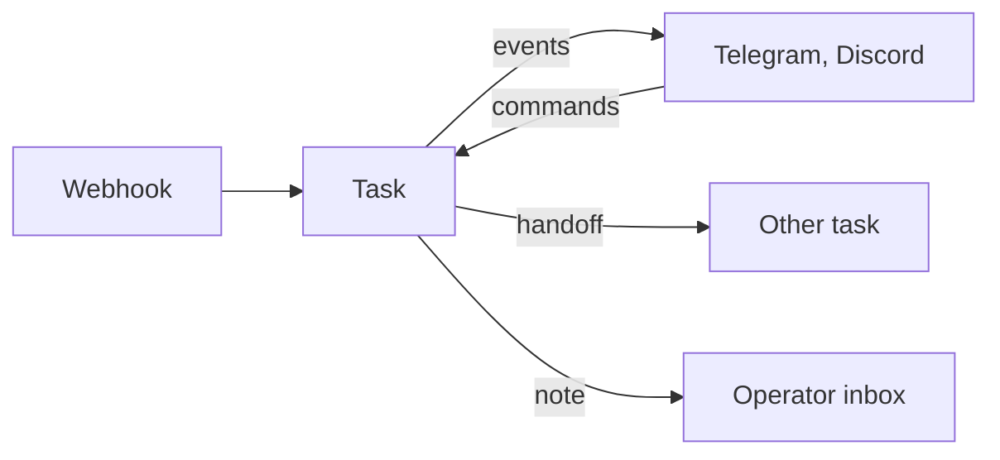

# Messaging, Telegram and webhooks

**Free:** Telegram and Discord notifications, context compaction. **Pro:** Telegram control, inter-task messaging, operator inbox, webhook triggers.

## Notifications (Free)

- Task start, success and failure to Telegram and Discord.
- Schedule runs name the schedule and quote the summary.

## Rich Telegram (Pro)

- **Formatted messages:** start (vendor, model, repo), success (git flow, PR link, attempts, turns, cost, duration), failure, failover, budget warnings, preflight blocks, daily digest.
- **One-tap plan approval:** inline Approve and Reject.
- **Several instances, one bot.** One instance polls and relays commands to the others.

| Command | Action |
|---|---|
| `/status` | Worker status, queue depth |
| `/approve KEY`, `/reject KEY` | Decide a waiting plan or workflow step |
| `/cancel KEY`, `/retry KEY` | Stop a running task, requeue a failed one |
| `/reply KEY message` | Message a task's agent |
| `/inbox` | Read agent messages to you |
| `/pause`, `/resume` | Pause or resume the queue |
| `/digest`, `/budget KEY` | Daily summary, task spend vs limits |

## Inter-task messages and inbox (Pro)

- Tasks send requests, responses, notes and handoffs. They can address the operator.
- Operator messages go to Telegram and Discord.
- Message a running task from its page, Sessions, Telegram or a remote agent. Delivered at its next step. Pi runs: straight into the live run.
- Secrets screened before storage or sending.

## Context compaction (Free)

**Compact** turns a cluttered run into a short brief: tried, files changed, failure modes, next steps, open questions. The agent restarts fresh. Automatic after several attempts or when a vendor reports a full context.

## Webhook triggers (Pro)

- One receiver URL per trigger. HMAC-verified.
- Runs the built-in webhook skill on the payload.
- *Plan* mode: a written plan. *Act* mode: a coding task.
- Tagged by origin. Read-only external tools only.

The pipeline runs alone. You stay in charge from your phone.

**Related:** [Product docs](https://capitaltools.app/devagentforce/docs#pro) · [Integrations](../handbook/integrations.md) · [Settings](../handbook/settings.md) · [Sessions observatory](sessions-observatory.md) · [Workflows](workflows.md) · [A2A gateway](a2a-gateway.md) · [Overnight multi-vendor batch](../../use-cases/03-overnight-multi-vendor-batch.md)
