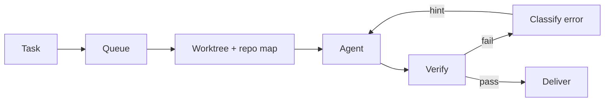

# Pipeline and tasks

**Free** core pipeline, **Pro** gates marked. Describe the work once. An agent runs it in an isolated checkout. Real build, test and lint judge the result.

## Task types

| Type | Repo | Produces |
|---|---|---|
| Coding | yes | PR, branch, commit, patch or uncommitted edits |
| Test | yes | Test results in the log |
| Script | yes | Script output. The description is the command |
| Skill | optional | `RESULT.md` in the result folder |
| Research | optional | Answer in the log and result folder |
| Admin | optional | Change journal. Off by default, behind host elevation |

## The run

1. **Create** from dashboard, template, idea, schedule, Telegram or integration. **Fill Task** expands one line via the System LLM.
2. **Queue.** Waits for a worker slot and the repository lock.
3. **Run** in the worktree with repo map, skills and attachments as real files.
4. **Verify:** pre-step, build, test, lint. Failure → classified hint, up to the retry limit.
5. **Deliver** by git flow. See [Git providers and flows](git-providers.md).
6. **Review.** The task ends in `test`, the success state.

## Mechanics

- **One queue.** Priority, then age, several at once.
- **Parallel vendors.** Different vendors share a repository. Same vendor, or local-checkout commits, wait for the lock.
- **Worktrees.** One per task, branch `agent/DEV-123`. Your checkout untouched.
- **Error-aware retries.** Import, compile, test, merge-conflict. Hard or repeating errors stop the loop.
- **Repo map.** Symbol index across many languages, before the first turn.
- **Timeline.** Typed live events: retries, errors, verification, failover, cost.
- **Analytics.** Queue, success rate, cost per vendor, duration, turns, tokens, cost per PR. 7 to 90 days.
- **Board.** Grid or kanban: Queued, Active, Needs You, Shipped, Stalled. Live.

**Statuses:** `pending`, `queued`, `running`, `verifying`, `test` (success), `failed`, `cancelled`. Waiting on you: `pending`.

**Controls:** Run / Re-run, Cancel, **Continue** (same session and branch, when turns ran out), **Compact** (short brief, fresh conversation).

**On completion:** verify, follow-up skill, script or another pending task. On success, failure or always. See [Schedules and scripts](schedules-and-scripts.md).

## Pro gates

- **Reality gate and abstain.** Codebase evidence scored before start. Too little: refused before spending.
- **Budget breaker.** Dollar and wall-clock cap, checked between attempts.
- **PR preflight.** Non-LLM: secret scan, plan scope, file size.
- **[Review loop](review-loop.md)** and **[Plan → Implement](workflows.md)**.

"Done" is what the compiler and tests say. You review verified work, not a chat.

**Related:** [Product docs](https://capitaltools.app/devagentforce/docs#tasks) · [Tasks](../handbook/tasks.md) · [Task types](../handbook/task-types.md) · [When a task finishes](../handbook/task-finish.md) · [Task lifecycle](../engineering/task-lifecycle.md) · [Reliability](../engineering/reliability.md) · [Context economy](../engineering/context-economy.md) · [Ticket to verified PR](../../use-cases/01-ticket-to-verified-pr.md)
