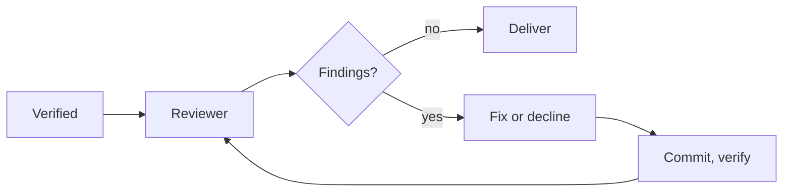

# Review loop

**Pro.** A reviewer reads the change. The task's agent fixes or declines. The verifier runs again. Repeat until clean.

## How it runs

- **Before delivery.** After the verifier, before PR preflight. Delivery unchanged.
- **Any vendor reviews.** Per task. Blank = task's own model. Another vendor = a real second opinion.
- **The original agent fixes.** Same session. Fix or decline with a reason. Nothing unrelated.
- **Verify after every fix.** A broken build gets one repair attempt.
- **No third party.** No PR bot. No new status: the task shows `verifying`.
- **Repository rules.** Markdown with path patterns, read as committed at run start. A run cannot weaken its reviewer.

## Keeping it honest

- Every finding quotes its code.
- Filtered: no evidence, low confidence, duplicates, already declined. Shown collapsed in the Review panel.
- Later rounds act on blocking findings only: unsafe code, broken contract, leaked secret, data loss, missing tests, false docs.

## Stop rules

Clean review. Round cap (last round always reviewed). Same finding returns. Budget spent. Reviewer, fixer or verifier fails.

- Rounds do not count against the retry limit. Spend counts against the task budget.
- Settings per task: on/off, reviewer vendor and model, max rounds. Workflow steps set their own.
- Timeline records every round. Every finding and verdict is kept.

Self-review agrees with itself. This catches what a human would, without the nitpicks.

**Related:** [Product docs](https://capitaltools.app/devagentforce/docs#review-loop) · [When a task finishes](../handbook/task-finish.md) · [Pro features](../handbook/pro.md) · [Workflows](workflows.md) · [Pipeline and tasks](pipeline-and-tasks.md) · [Reliability](../engineering/reliability.md) · [Pre-ship review loop](../../use-cases/05-pre-ship-review-loop.md)
