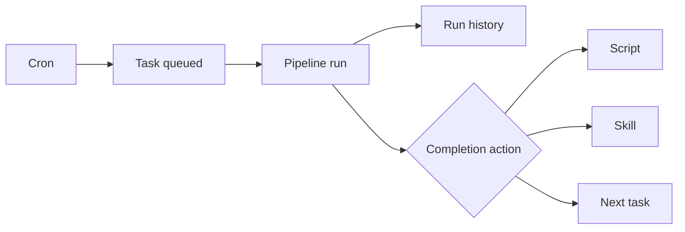

# Schedules, scripts and templates

**Free.** Cron re-runs, one-click scripts, follow-up actions and task templates.

## Schedules

- Name + cron expression → an **existing task**.
- Shorthand: `@hourly`, `@daily`, `every 30m`, `every 2h`, a time of day.
- Each run resets and queues the task. Already queued or running: skipped. No double runs.
- **History:** status, time, summary, `RESULT.md` snapshot. Newest 30 kept by default.
- **Fails loudly.** Invalid cron or time zone refused with the parser's message. A stored schedule that no longer parses is skipped with a warning. Never a guessed cadence.
- Run now or stop mid-run: **Settings → Jobs**.

## Scripts

- A **script task** stores a command. The description is the command.
- **Scripts** menu: every script task by repository. Runs directly. No queue, no agent, no worktree.
- Output streams to Ask Agent. Detached: a platform restart cannot kill it.
- `.sh` runs under bash. Windows too, with Git for Windows.
- Log readable after a reload. Redacted.

## Action on completion

- **Verify** (default for coding), a **script**, a **skill** (e.g. code review on the diff), or another **pending task**.

- Trigger: **on success**, **on failure** (includes budget stops and preflight failures), **always**.
- A follow-up that cannot start is reported. The original result stands.
- A task cannot chain to itself.

## Templates

Saves every task field, from description to billing mode and verification. Use for checklists, dependency bumps, audits. Anything typed twice.

Routine work runs on time, verified, with an audit trail.

**Related:** [Product docs](https://capitaltools.app/devagentforce/docs#script-tasks) · [Templates, ideas and schedules](../handbook/templates-ideas.md) · [When a task finishes](../handbook/task-finish.md) · [Skills and artifacts](skills-and-artifacts.md) · [Pipeline and tasks](pipeline-and-tasks.md) · [Scheduled skills: job search](../../use-cases/07-scheduled-skills-job-search.md)
