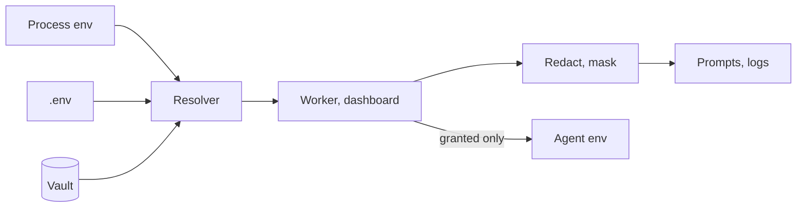

# Secrets vault and the five layers of protection

**Free:** encrypted vault, redaction, sign-in, machine-detail masking. **Pro:** secret-injection governance, PR preflight. Secrets stay out of prompts, logs, commits and your AI vendor.

## The vault

- **AES-256-GCM at rest.** Values encrypted. Names and metadata readable.
- **Replaces `.env` key by key.** Settings edits go to the vault. Delete a key from `.env` to hand it over. Undoable.
- **Precedence:** process env (your override) > `.env` > vault > built-in default.
- **No accidental reveal.** Lists show existence and a short fingerprint. Values need an explicit reveal.
- **Scopes:** global, environment, repository, integration. Most specific wins.
- **Operations:** generate, rotate (rewrap), restore, wipe with confirmation. Dashboard or host command line.

## Five layers

| # | Layer | Edition |
|---|---|---|
| 1 | **Locked vault.** Replaces plaintext `.env`. Never hands a secret back | Free |
| 2 | **Redaction.** Known secrets and key-shaped strings wiped from prompts, logs, agent messages | Free |
| 3 | **Need-to-know injection.** Only granted secrets. Hidden ones brokered, not handed over | Pro |
| 4 | **PR preflight.** Keys, passwords, private files caught before Gitea, GitHub or Azure DevOps | Pro |
| 5 | **Machine-detail masking.** Host paths and identifying details masked from your AI vendor | Free |

## What an agent never sees

- Internal platform tokens. Git-provider tokens.
- Other vendors' API keys. Each CLI keeps only its own.
- Pro: any other secret unless granted to that repository or task.

**Untrusted input.** Descriptions, imported work items and failure output are cleaned of invisible characters and hidden instructions. They reach the agent marked as untrusted data.

## Dashboard sign-in (Free)

- `ENABLE_LOGIN_PAGE=true` plus login and password. Every page and API route gated. Off by default.
- Signed session cookies tied to client address. Password change ends all sessions.
- One-time setup link. No printed password.
- Cross-origin state changes refused. Blocks cross-site and DNS-rebinding tricks.
- **Task tokens:** a local client (editor extension) can create a coding task and read its status. Nothing else.

## Host boundary

Both services bind `LISTEN_HOST`, default `127.0.0.1`. To expose, use a reverse proxy or private network.

"Please don't leak" becomes an enforced boundary.

**Related:** [Product docs](https://capitaltools.app/devagentforce/docs#security) · [Secrets](../handbook/secrets.md) · [Access and sign-in](../handbook/access.md) · [Secrets FAQ](../handbook/faq-secrets.md) · [Security model](../engineering/security-model.md) · [Security policy](../../SECURITY.md)
