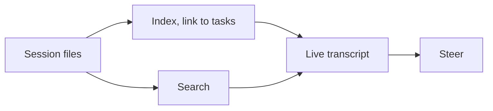

# Sessions observatory

**Pro.** Every agent session on the host, live. Steer mid-flight. Search all transcripts.

## What you get

- **Every session, not only ours.** One tab per active vendor: Claude Code, Codex, Antigravity, Pi. Includes sessions you started by hand.
- **Linked to tasks.** Shows task and repository. Retries, continuations and failover fold to the newest per task.
- **Live transcripts.** Assistant turns, tool calls, tool results. Long events expand on demand. All redacted.
- **Opens on the running task's** vendor tab.
- **Steering:** message, approve or reject a plan, answer a side-effect gate, stop. Pi: into the live run. Others: next attempt.
- **Session search** across every provider. A hit opens the session, term highlighted.
- **Usage batteries** where the vendor reports limits. Never estimated.
- **Save as idea** to the [Ideas backlog](ideas-backlog.md), as markdown.
- **Housekeeping.** Delete old sessions. Live ones are protected.

## How it works

- Reads the files each CLI already writes. No wrapping. No proxy.
- Search scans raw files, then confirms hits against rendered text.
- Bounded in time and size. Says when results were cut.
- Polling resumes after laptop sleep. Timeouts count active time only.

Catch a wrong turn with one message, before the budget is gone.

**Related:** [Product docs](https://capitaltools.app/devagentforce/docs#sessions) · [Sessions](../handbook/sessions.md) · [Pro features](../handbook/pro.md) · [Messaging and Telegram](messaging-and-telegram.md) · [Agent backends](agent-backends.md) · [Architecture](../engineering/architecture.md)
