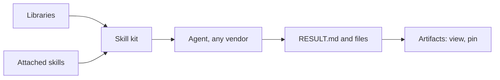

# Skills and artifacts

**Free:** skills, libraries, presets, light tasks, result folders. **Pro:** artifact registry with pinned inputs. Write a procedure once. Call it on any vendor.

## Skills

- **A folder with `SKILL.md`**, open Agent Skills format, declared **parameters**.
- A *Skill* task calls one. Any task can **attach** skills as know-how.
- **Every vendor.** Installed where each CLI looks and added to the prompt.
- **Parameters:** task value > operator default > skill default. Required and missing: the agent stops.
- **Presets:** code review, TDD, bug diagnosis, design "grill-me", minimal senior changes, writing for agents, webhook handling, verify.
- **Libraries** from folders, pinned git repos, archives, catalogues. Read-only. Duplicate to edit.
- **Safe import.** `.md`, `.zip`, `.skill` scanned for secret-shaped strings and malicious instructions.
- **Save as skill** from a finished task. Needs your confirmation.
- **Git only when declared.** Never push, change remotes, hard-reset or clean.
- **Usage:** calls, attachments, dependency pulls, cost.

## Light tasks

Skill, research, admin and repo-less tasks. No worktree. No PR.

- Own **result folder**, outside the repository. `git status` stays clean.
- **`RESULT.md` is the deliverable.** None written: the final message is saved.
- **Schedules keep history.** Each run snapshots the folder.

## Artifact registry (Pro)

- Task files registered with kind, size, vendor, model. Latest version kept.
- Drawer or full page. Download. Previews redacted.
- **Pinned inputs.** Earlier artifacts as read-only inputs. This is how an approved `PLAN.md` reaches Implement.
- Missing pinned input: the task fails up front. No guessing.

Repeated work becomes a versioned procedure. Output becomes files you keep and reuse.

**Related:** [Product docs](https://capitaltools.app/devagentforce/docs#skills) · [Skills](../handbook/skills.md) · [Task types](../handbook/task-types.md) · [Workspace](../handbook/workspace.md) · [Workflows](workflows.md) · [Schedules and scripts](schedules-and-scripts.md) · [Research with artifacts](../../use-cases/06-research-with-artifacts.md) · [Scheduled skills: job search](../../use-cases/07-scheduled-skills-job-search.md)
