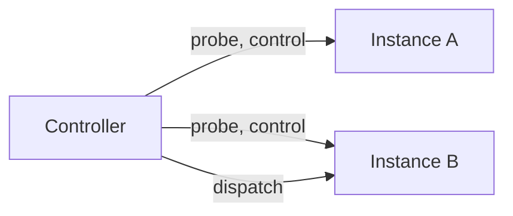

# Worker fleet and release notices

**Pro:** Crew page with registry, remote control, dispatch. **Free:** release notices, cloud VM stack, parallel tasks on one machine.

## Crew (Pro)

- **Registry.** Add each machine by dashboard address and port.
- Reached through the dashboard, never a raw worker port. Same authentication.
- **Liveness:**

| State | Meaning |
|---|---|
| Online | Dashboard and worker answer |
| Degraded | Dashboard answers, worker down |
| Offline | Unreachable. Probe error shown |

- All nodes probed at once. Summary row: nodes, online, degraded, active tasks.
- **Remote control:** Restart, Stop, Pause, Start. Running and queued counts.
- **One controller.** *Make controller* moves the role.
- **Dispatch and migration** with a crew credential. See [A2A gateway](a2a-gateway.md).
- **One Telegram bot.** One instance polls and relays.

## Release notices (Free)

- The worker checks for newer builds for its platform.
- Notice: dashboard footer, desktop tray, optional Telegram.
- **Notifies. Never installs.** Re-run the one-line installer to update. Native, desktop or cloud VM.
- Off switch: Settings → General.

## Parallel without a fleet (Free)

One worker runs several tasks. Different vendors share a repository in parallel.

Fleet traffic uses each web tier. Workers listen on localhost or a private network you configure.

Desktop by day, server overnight, VM for the team. One page. No orchestration product.

**Related:** [Updating docs](https://capitaltools.app/devagentforce/docs#updating) · [Changelog](https://capitaltools.app/devagentforce/changelog) · [Updating](../handbook/updating.md) · [Native install](../handbook/native.md) · [Pro features](../handbook/pro.md) · [A2A gateway](a2a-gateway.md) · [Messaging and Telegram](messaging-and-telegram.md) · [Architecture](../engineering/architecture.md)
