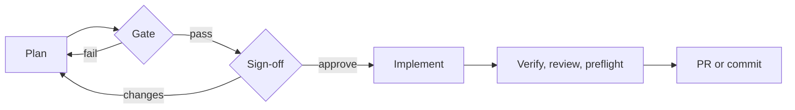

# Workflows: Plan → Implement

**Pro.** An agent writes a plan. It is checked and approved. Then implemented as a verified coding task.

## Plan → Implement

Built-in templates for features and bug fixes:

1. **Plan.** A light step writes `PLAN.md`: approach, order, files to touch.
2. **Plan gate.** Checked against the step contract: sections, front matter, length, diagram types. Fail → sent back with the failure report only. Repeated failure parks the workflow.
3. **Sign-off.** Waits for you, unless *Auto-approve plan* was ticked. Approve with guidance for the next step.
4. **Implement.** A normal coding task: git flow, review loop, verifier, budget. The plan's file list is the PR preflight allow-list.

One conversation throughout. Each step resumes the previous session on the same vendor.

## Custom templates

Editable in the dashboard. Duplicate a built-in to change it.

- **Branch** on step outcome or an artifact's front matter field.
- **Loop** with an iteration cap and an exit target.
- **Fan out** a light step to 2–4 vendors. Competing plans or reviews.
- **Chain coding steps** into one delivery: one branch, commit series or set of edits.
- Per-step **review rounds**.
- Live Mermaid diagram, steps coloured by status.

## Steering

- Each step's task page shows the diagram, "Step n of N" and controls.
- **Pause**, **Resume**, **Park** (stop now, keep output), **Force next step** (optional guidance), **Cancel**.
- Request plan changes by chat to the waiting step.
- Free text is never a command. "approve" in a message approves nothing.
- **Workflow budget** on top of task caps. Reached: parks before the next step.
- Telegram `/approve`, `/retry` work on steps. Ask Agent lists, saves and starts templates.

Good code for the wrong design is the costliest mistake. A checked plan catches it before any file is touched.

**Related:** [Product docs](https://capitaltools.app/devagentforce/docs#pro) · [Workflows](../handbook/workflows.md) · [Pro features](../handbook/pro.md) · [Review loop](review-loop.md) · [Skills and artifacts](skills-and-artifacts.md) · [Pipeline and tasks](pipeline-and-tasks.md) · [Task lifecycle](../engineering/task-lifecycle.md) · [Plan then implement](../../use-cases/02-plan-then-implement.md)
