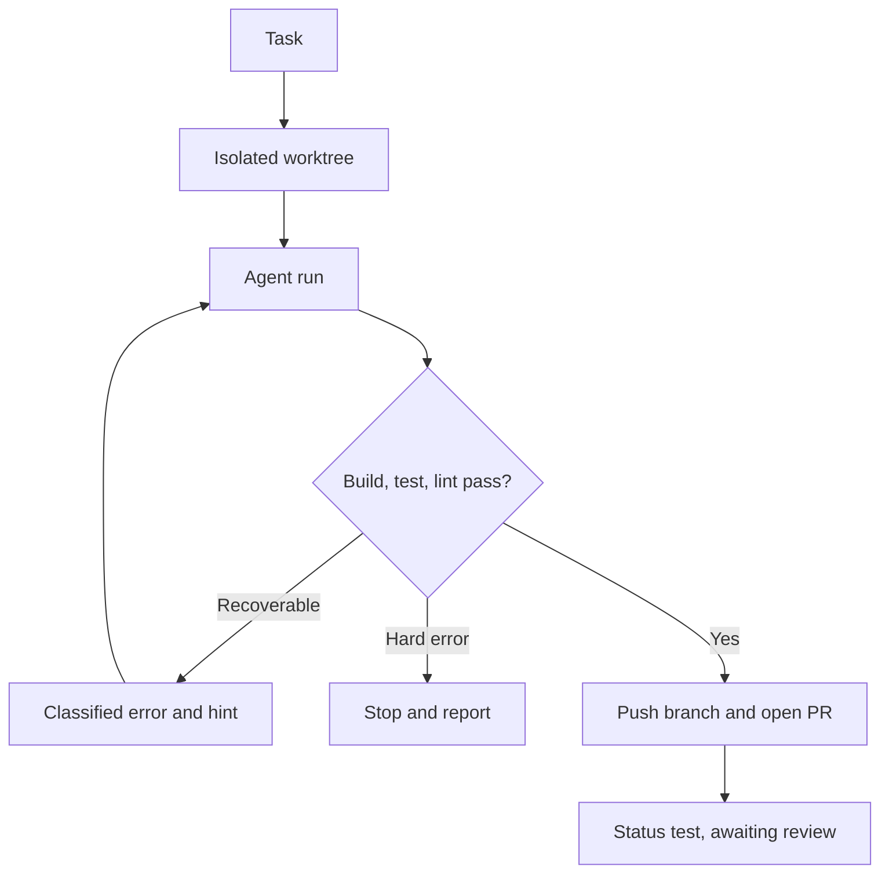

# 01 — Ticket to verified pull request

A written ticket becomes a PR that already passed your build, tests and lint. **Free** + Pro

## Problem

A terminal agent writes code. Someone still runs the build, feeds back failures, retries and opens the PR.

## Who it's for

- Teams with a steady stream of well-scoped tickets.
- Tech leads who want reviewable PRs, not chat transcripts.
- Evaluators who want deterministic gates, not trust in a model.

## How it runs

1. **Register the repo** on Repos: clone URL (Gitea, GitHub or Azure DevOps, detected from the URL), a token, and **Build / Test / Lint / Pre** commands.
2. **Create a task:** description, acceptance criteria, git flow **Branch + PR**, vendor and model (Claude Code, Codex, Antigravity or Pi). **Fill Task** expands a one-liner; templates pre-fill repeat work.
3. **Queue.** The task gets its own git worktree. Your checkout is never touched.
4. **Run.** The agent receives the task, a repo symbol map and the criteria.
5. **Verify.** The worker runs your build, test and lint commands itself.
6. **Retry.** Errors are classified. Recoverable ones return with a hint. Hard errors stop at once.
7. **Ship.** On green, `agent/<task-key>` is pushed and a PR opened. Status: `test`, awaiting your review.

## What you get

- A PR that passed **your** build, tests and lint.
- A live timeline: attempts, errors, verifications, agent log, cost, turns, tokens.
- Telegram or Discord notifications on start, success and failure.
- **Continue** resumes the session. **Compact** restarts from a short summary.

## Edition

- **Free:** queue, worktrees, all four vendors, error-aware retries, repo map, verifier, PRs on all three hosts. Runs on API keys.
- **Pro adds:** PR preflight (secret, file-size and scope scan before push), budget circuit breaker (cost and wall-clock ceilings), reality gate (declines under-specified tasks), subscription (Max) billing, Azure DevOps work-item import.

## Related

[Pipeline and tasks](../docs/features/pipeline-and-tasks.md) · [Git providers](../docs/features/git-providers.md) · [Agent backends](../docs/features/agent-backends.md) · [Handbook: tasks](../docs/handbook/tasks.md) · [Handbook: repos and git flows](../docs/handbook/repos.md) · [Handbook: finishing a task](../docs/handbook/task-finish.md) · [Task lifecycle](../docs/engineering/task-lifecycle.md) · capitaltools.app: [Tasks](https://capitaltools.app/devagentforce/docs#tasks) · [Repositories](https://capitaltools.app/devagentforce/docs#repos)
