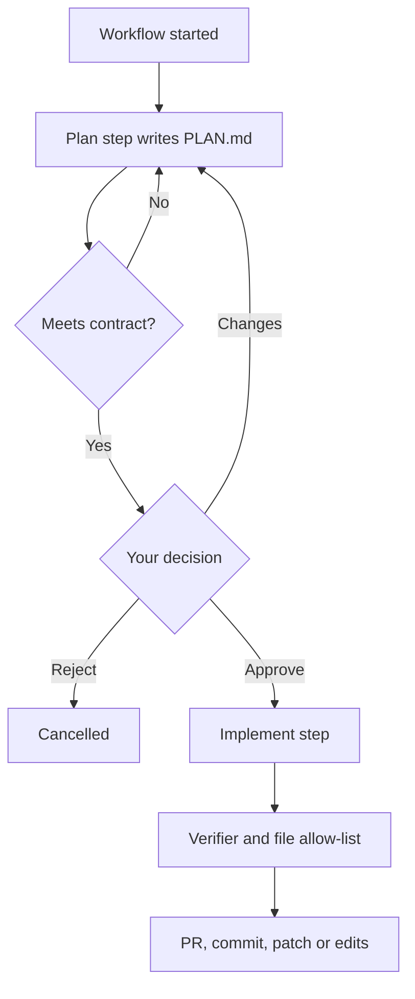

# 02 — Plan, then implement

The agent writes a plan. You approve it. Only then is code written. **Pro**

## Problem

On bigger work, an agent that edits at once may misread intent or touch unexpected files. You want a binding plan approval — without watching the dashboard.

## Who it's for

- Teams where scope control beats raw speed.
- Leads who approve from a phone between meetings.
- Regulated teams that must record a human decision before code changes.

## How it runs

1. **Start a workflow.** New Task → **Workflow** → template `feature` (Plan then Implement) or `bugfix` (plan must name a failing test). Or ask **Ask Agent**: it shows a **Run / Edit / Reject** card. Nothing starts until Run.
2. **Plan.** An agent writes `PLAN.md`: approach, order of work, exact files to touch.
3. **Check.** The plan must meet the step's contract: required sections, file list, length cap. Misses go back with findings.
4. **Sign off** from any channel:
   - Dashboard: **Approve Plan**, with optional guidance.
   - Telegram: `/approve <TASK-KEY>`.
   - Chat to the step's task: request changes. The plan is revised and re-checked.
   - Reject is Cancel.
5. **Implement.** A normal coding task: worktree, verifier, retries, git flow. The approved file list is an allow-list; PR preflight flags anything outside it.
6. **Steer remotely.** Telegram `/status`, `/pause`, `/resume`, `/budget`, `/reply <TASK-KEY> <message>`, `/retry`. Ask Agent explains the page you are on.

## What you get

- A reviewable plan before a single file changes.
- A binding approval: implementation is held to the approved file list.
- A workflow diagram on each step's page, with Pause, Resume, Park and Force next step.
- Built-in `multi-review` template: three vendors review in parallel, one merged plan, Implement fixes.
- For one task, **interactive mode**: plan, Telegram Approve/Reject buttons, enforced file list.

## Edition

- **Pro:** workflows and templates, plan sign-off, file allow-list, PR preflight, rich Telegram (inline Approve/Reject, `/reply`, `/budget`, `/digest`), Ask Agent workflow tools.
- **Free:** Ask Agent chat, basic Telegram notifications, `/status`, `/pause`, `/resume`. Free alternative to a plan gate: run `grill-me` first ([use case 06](06-research-with-artifacts.md)), then code from its spec.

## Related

[Workflows](../docs/features/workflows.md) · [Ask Agent](../docs/features/ask-agent.md) · [Messaging and Telegram](../docs/features/messaging-and-telegram.md) · [Handbook: workflows](../docs/handbook/workflows.md) · [Handbook: assistant](../docs/handbook/assistant.md) · [Handbook: settings](../docs/handbook/settings.md) · capitaltools.app: [Ask Agent](https://capitaltools.app/devagentforce/docs#ask-agent) · [Pro features](https://capitaltools.app/devagentforce/docs#pro)
