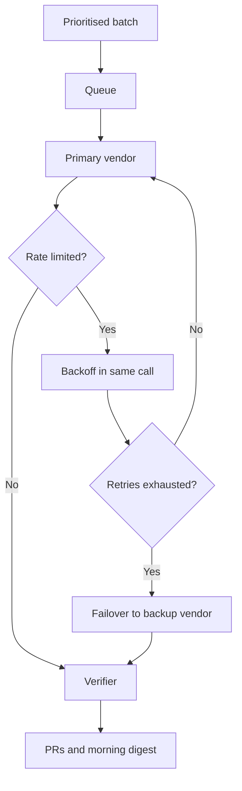

# 03 — Overnight multi-vendor batch

Queue the batch. Walk away. Read the summary at breakfast. **Free** + Pro

## Problem

One vendor's rate limit stalls the batch by task five. Switching vendors by hand costs the night.

## Who it's for

- Small teams that want the backlog to move overnight.
- Engineers with keys or subscriptions at several vendors.
- Anyone who lost a night of work to a single 429.

## How it runs

1. **Queue.** Create tasks by hand, from templates, from Ideas nodes or via Ask Agent. Priority 1 (critical) to 4 (low); dispatch by priority, then age.
2. **Spread vendors.** Set a primary and a **backup** vendor and model per task. Different vendors run side by side, even on one repo — each task has its own worktree.
3. **Absorb 429s.** Retried inside the same call with growing backoff. No task retry spent.
4. **Fail over.** If the primary exhausts retries: work is committed, the backup starts a fresh session, you are notified.
5. **Hold the gates.** Every task passes the verifier. Pro adds per-task cost and wall-clock ceilings, with a warning first.
6. **Report.** Telegram or Discord carry start, success, failure and failover. Pro `/digest` summarises results and cost; analytics show cost per PR, duration, tokens.

## What you get

- A batch that keeps moving when a vendor throttles or fails.
- Status, cost, duration and attempts for every task in one place.
- Verified PRs, patches, commits or edits — per task. Failures state why.
- After a worker restart, interrupted tasks return to `pending`. **Re-run** or **Continue**.

## Edition

- **Free:** queue, priorities, all four vendors, per-vendor parallelism, retries, backoff, failover, analytics, Telegram/Discord. Bills via API keys.
- **Pro adds:** subscription (Max) billing on Claude Max, ChatGPT Plus or Google AI Pro/Ultra logins; budget breaker; daily digest and `/budget`; live Sessions observatory to watch and steer.

## Related

[Agent backends](../docs/features/agent-backends.md) · [Pipeline and tasks](../docs/features/pipeline-and-tasks.md) · [Messaging and Telegram](../docs/features/messaging-and-telegram.md) · [Sessions observatory](../docs/features/sessions-observatory.md) · [Handbook: vendors and billing](../docs/handbook/vendors.md) · [Handbook: queue](../docs/handbook/faq-queue.md) · [Reliability](../docs/engineering/reliability.md) · capitaltools.app: [Vendors](https://capitaltools.app/devagentforce/docs#vendors) · [Sessions](https://capitaltools.app/devagentforce/docs#sessions)
