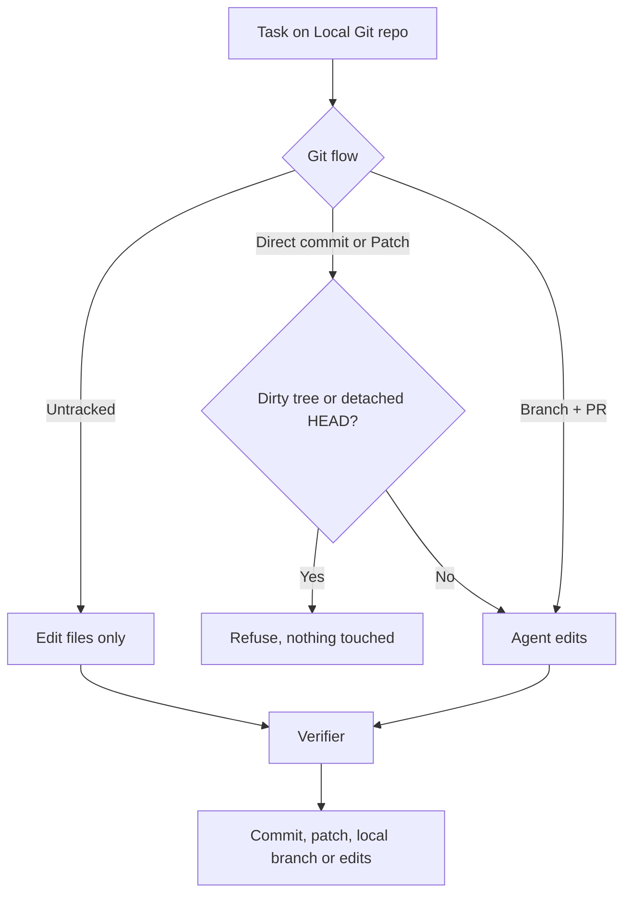

# 04 — Local repository, no remote

Agents work in a plain local git folder. Commits are yours. Nothing is pushed. **Free**

## Problem

Your code may sit on GitLab, Bitbucket, a NAS or only your laptop. Handing an agent your real folder risks a `reset --hard` or a stray push.

## Who it's for

- Solo developers and consultants in local clones.
- Teams on unsupported hosts or air-gapped networks.
- Anyone who wants agent commits on their own branch, never leaving the machine.

## How it runs

1. **Add a Local Git repo** on Repos: set **Local Root Folder** to an existing clone. No clone, no token. **Local** badge.
2. **Pick a git flow per task:**

| Flow | Result |
|---|---|
| Untracked | Edits only. You review and commit. |
| Direct commit | Committed on your checked-out branch, your identity. Never pushed. |
| Patch | Commits on local `agent/<task-key>`, patch series produced, original branch restored. |
| Branch + PR | Push and PR only if origin accepts. Otherwise the branch stays local; task still succeeds. |

3. **Pre-checks.** Direct commit and Patch refuse a dirty tree. Direct commit refuses a detached HEAD.
4. **Work in place.** The agent never pushes, touches remotes, runs `reset --hard` or `clean -fdx`. The only push is the platform's best-effort step in Branch + PR. Committing tasks take a repo lock.
5. **Verify and commit.** Your build, test and lint run in the folder. On green, the flow completes.

## What you get

- Any clone from any host works. No host API involved.
- Commits authored by you. No AI trailers or co-author tags.
- Your folder is never reset or cleaned. No push unless Branch + PR with a usable origin.
- Same task page, verifier, retries and notifications as hosted repos.
- Light tasks leave `git status` clean; output goes to a separate result folder.

## Edition

- **Free:** Local Git repos, all four flows, safety checks, verifier, retries, notifications.
- **Pro adds:** patch export as a ready-to-apply mailbox file; PR preflight's secret, file-size and scope scan before the commit lands.

## Related

[Git providers](../docs/features/git-providers.md) · [Cross-repository work](../docs/features/cross-repo.md) · [Handbook: repos and git flows](../docs/handbook/repos.md) · [Handbook: across repositories](../docs/handbook/workspace.md) · [Security model](../docs/engineering/security-model.md) · capitaltools.app: [Repositories](https://capitaltools.app/devagentforce/docs#repos) · [Security](https://capitaltools.app/devagentforce/docs#security)
