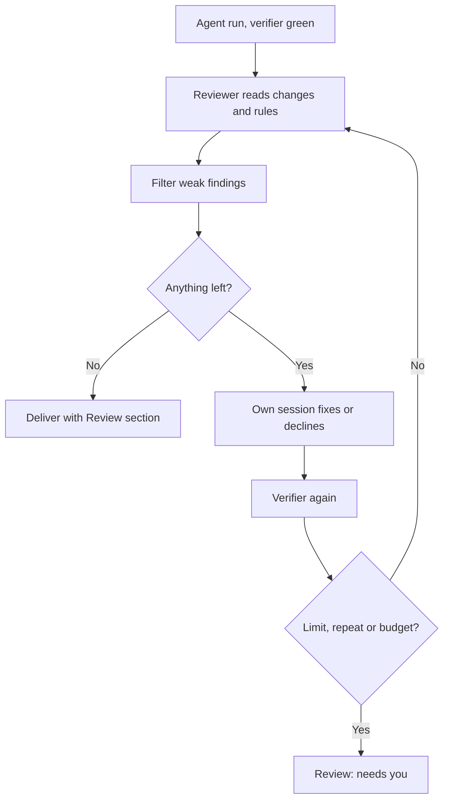

# 05 — Pre-ship review loop

A second agent reviews. The first fixes. The verifier re-runs. Then it ships. **Pro**

## Problem

Green tests can still hide a missed edge case, a broken contract or a leaked secret. Human review catches it a day later.

## Who it's for

- Teams that want human review to be a final read, not a bug hunt.
- Leads who want a second model's opinion on every change.
- Repos with house rules reviewers keep repeating.

## How it runs

1. **Enable** on a coding task: **Review the changes before delivering**. Optional reviewer vendor and model (blank = task's own) and **max rounds** (1–10).
2. **Run.** Agent works, verifier passes — as in [use case 01](01-ticket-to-verified-pr.md).
3. **Review.** A read-only reviewer reads this run's changes, commit messages, and your rules in `.daf/review-rules/`.
4. **Filter.** Findings without quoted evidence, low-confidence, duplicate or already declined are set aside. They never reach the fixer.
5. **Fix or decline.** The task's **own** session fixes each finding or declines it with a reason. Declined findings are not raised again.
6. **Re-verify.** Fixes are committed (if the flow commits). Verifier re-runs. Next round.
7. **Stop** when clean, round limit hit (last round reviewed, never fixed unreviewed), a finding repeats, or budget is spent. From round 3, only blocking findings trigger a fix.
8. **Deliver** as usual — PR, commit, patch or edits. The PR body gets a Review section.

## What you get

- PRs that survived structured review and re-verification.
- Cross-vendor second opinion, e.g. Claude Code writes, Codex reviews.
- Every finding and verdict on the task timeline.
- No silent shipping. A stopped loop shows **Review: needs you** with open findings. On a remote direct-commit flow with a blocking finding, nothing is pushed. **Continue** resumes from the kept worktree.
- Rounds spend no task retries. Their cost and time count toward the budget.

## Edition

- **Pro:** review loop, reviewer choice, filtering, stop rules, PR Review section. Workflow coding steps set their own rounds; `multi-review` runs three reviewers in parallel.
- **Free alternative:** set **Run action on completion** to the `code-review` skill. A child task reviews the parent's changes and writes a report. Fixes are a follow-up task.

## Related

[Review loop](../docs/features/review-loop.md) · [Workflows](../docs/features/workflows.md) · [Skills and artifacts](../docs/features/skills-and-artifacts.md) · [Handbook: review loop and follow-ups](../docs/handbook/task-finish.md) · [Handbook: Pro](../docs/handbook/pro.md) · capitaltools.app: [Review loop](https://capitaltools.app/devagentforce/docs#review-loop)
