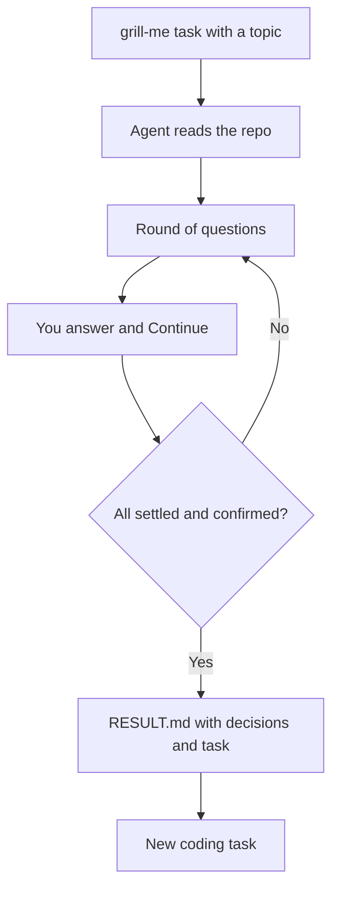

# 06 — Research and design with artifacts

Light tasks deliver a durable `RESULT.md`, not a chat that scrolls away. **Free** + Pro

## Problem

Research and design produce no code. In a chat, results vanish, and the model answers its own questions.

## Who it's for

- Architects and leads who want decisions written before building.
- Product engineers turning a vague idea into a buildable spec.
- Anyone who wants research as a file next to the task.

## How it runs

1. **Pick a light task type.** **Research** (description is the prompt, answer is the deliverable) or **Skill** (reusable SKILL.md procedure with parameters). Repo optional; read-only, nothing committed.
2. **Example: a design grilling.** Skill task, preset `grill-me`, topic e.g. "add multi-tenant billing". Depth `quick` (architecture-changing branches only) or `thorough`.
3. **Round one.** The agent reads the repo first, maps a decision tree, and asks a numbered round of questions. Each has a recommended answer and a status: settled, open now, later.
4. **Answer** with a message and **Continue**. The agent pushes back on vague answers and asks the next round. It never answers its own questions.
5. **Spec.** When nothing is open and you confirm: summary, decisions table (decision, choice, reason), out of scope, risks, open questions, and a ready-to-run task with acceptance criteria.
6. **Collect.** `RESULT.md` lands in the task's result folder, outside the repo. `git status` stays clean.
7. **Hand on.** Paste the ready-to-run block into a coding task, or **Save as skill**.

## What you get

- A decision record to review, diff and archive, tied to its task.
- A spec precise enough for an autonomous coding task.
- Same queue, vendors, failover and notifications as coding tasks.
- More presets: `diagnosing-bugs`, `code-review`, `tdd`, `senior-code`, `writing-for-agents`, plus your own libraries.

## Edition

- **Free:** Research and Skill tasks, result folder, `RESULT.md`, all presets, skill libraries, parameter defaults, Save as skill.
- **Pro adds:** artifact registry — every `RESULT.md`, `PLAN.md` and output opens in a viewer on the task page and in Sessions, Mermaid rendered. Pinned inputs pass an earlier artifact to a later task or step, read-only. Live Sessions chat to answer a round beside the transcript.

## Related

[Skills and artifacts](../docs/features/skills-and-artifacts.md) · [Workflows](../docs/features/workflows.md) · [Handbook: skills](../docs/handbook/skills.md) · [Handbook: task types](../docs/handbook/task-types.md) · [Context economy](../docs/engineering/context-economy.md) · capitaltools.app: [Skills](https://capitaltools.app/devagentforce/docs#skills)
