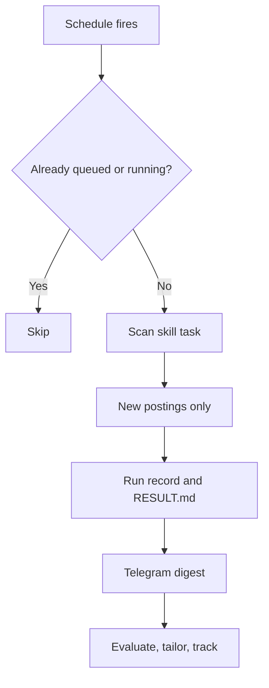

# 07 — Scheduled skills: a job search on autopilot

Skills run on a schedule, keep every result and send a Telegram digest. **Free**

Not only for code. The same pattern fits competitor monitoring, dependency audits or weekly reports. A job search is the example because it uses every part.

## Problem

A job search is a pipeline: scan, judge, tailor, track, follow up. A chat assistant forgets, repeats postings and embellishes resumes.

## Who it's for

- Engineers who want a disciplined, auditable search in the background.
- Anyone automating a recurring research routine with skills.
- Reviewers checking how scheduled agents stay honest: every claim traces to a source file.

## How it runs

1. **Data folder:** master CV, profile (titles, markets), boards with filters, a tracker.
2. **Add the skill library** on Skills and press **Sync**. Each skill is security-scanned; network warnings on scanners are expected.
3. **Set `data_dir` once** in Skills settings. Tasks, schedules and `/skill run` pre-fill it. Precedence: task value, your default, skill default.
4. **Schedule the scan.** Create a Skill task. Settings → Jobs → add e.g. `mon,thu 08:00` with an IANA time zone. Next fire time shown, correct across DST.
5. **Each fire** resets the task to pending and queues it. A fire while queued or running is skipped. Telegram quotes the run summary: new matches.
6. **Act on demand.** Evaluate a posting (scored, evidence quoted verbatim from the CV, AI-aimed text flagged). Tailor the resume (mandatory fact check removes invented employers, altered numbers or dates, copied posting text, and lists each removal). Update the tracker.
7. **More schedules:** weekday follow-up drafts (never sent for you), weekly funnel summary, liveness check for expired postings — dry run first.
8. **History.** Settings → Jobs → **Runs**: status, time, summary and its own `RESULT.md`, never overwritten. Newest 30 per schedule kept by default.

## What you get

- A routine that runs without you and never repeats a finding.
- Browsable history, one result file per run.
- Writing fact-checked against your own documents.
- A strict schedule grammar: `@hourly`, `@daily`, `@weekly`, `every 30m`, `every 2d at 09:00`, `HH:MM`, `weekdays 09:00`. Bad input and bad time zones are refused at save; an unparseable stored schedule is skipped with a warning.

## Edition

- **Free:** everything here — schedules with time zones, run history, skills, libraries, parameter defaults, Telegram summary. **Run** fires a schedule now.
- **Pro adds (optional):** rich Telegram and the daily digest; artifact viewer for each run's files.

## Related

[Schedules and scripts](../docs/features/schedules-and-scripts.md) · [Skills and artifacts](../docs/features/skills-and-artifacts.md) · [Messaging and Telegram](../docs/features/messaging-and-telegram.md) · [Handbook: skills](../docs/handbook/skills.md) · [Handbook: templates and ideas](../docs/handbook/templates-ideas.md) · capitaltools.app: [Skills](https://capitaltools.app/devagentforce/docs#skills) · [Script tasks](https://capitaltools.app/devagentforce/docs#script-tasks)
